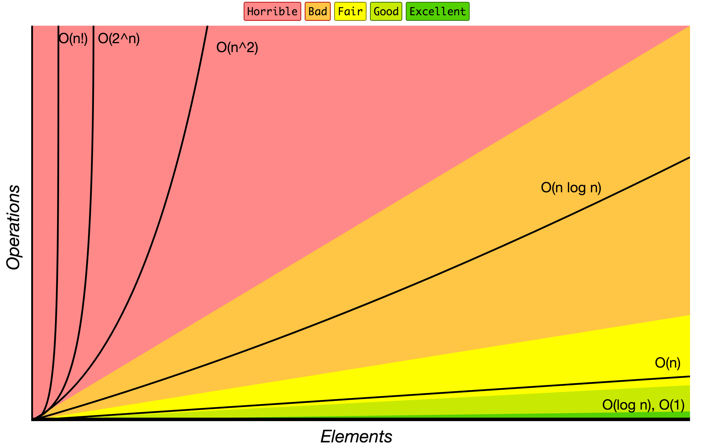

# JavaScript Algorithms and Data Structures

> 🇺🇦 ఉక్రెయిన్ మీద రష్యా ఆర్మీ [దాడి చేస్తోంది](https://war.ukraine.ua/). సామాన్య జనాలు చనిపోతున్నారు. ఇళ్ళు ఉన్న ఏరియాల మీద బాంబులు వేస్తున్నారు.
> - ఉక్రెయిన్‌కి ఇలా హెల్ప్ చేయొచ్చు:
>   - [Serhiy Prytula Charity Foundation](https://prytulafoundation.org/en/)
>   - [Come Back Alive Charity Foundation](https://savelife.in.ua/en/donate-en/)
>   - [National Bank of Ukraine](https://bank.gov.ua/en/news/all/natsionalniy-bank-vidkriv-spetsrahunok-dlya-zboru-koshtiv-na-potrebi-armiyi)
> - ఇంకా డీటెయిల్స్ కావాలంటే [war.ukraine.ua](https://war.ukraine.ua/) ఇంకా [MFA of Ukraine](https://twitter.com/MFA_Ukraine) చూడండి

<hr/>

[](https://github.com/trekhleb/javascript-algorithms/actions?query=workflow%3ACI+branch%3Amaster)
[](https://codecov.io/gh/trekhleb/javascript-algorithms)


ఈ repository లో బాగా పాపులర్ అయిన algorithms ఇంకా data structures కి
JavaScript లో రాసిన examples ఉన్నాయి.

ప్రతి algorithm కి, ప్రతి data structure కి సెపరేట్ గా ఒక README ఉంది.
అందులో దాని గురించి explanation, ఇంకా ఎక్కువ చదువుకోడానికి links (YouTube వీడియోలు కూడా) ఉంటాయి.

_వేరే భాషల్లో చదవాలంటే:_
[_English_](README.md),
[_简体中文_](README.zh-CN.md),
[_繁體中文_](README.zh-TW.md),
[_한국어_](README.ko-KR.md),
[_日本語_](README.ja-JP.md),
[_Polski_](README.pl-PL.md),
[_Français_](README.fr-FR.md),
[_Español_](README.es-ES.md),
[_Português_](README.pt-BR.md),
[_Русский_](README.ru-RU.md),
[_Türkçe_](README.tr-TR.md),
[_Italiano_](README.it-IT.md),
[_Bahasa Indonesia_](README.id-ID.md),
[_Українська_](README.uk-UA.md),
[_Arabic_](README.ar-AR.md),
[_Tiếng Việt_](README.vi-VN.md),
[_Deutsch_](README.de-DE.md),
[_Uzbek_](README.uz-UZ.md),
[_עברית_](README.he-IL.md)

## Data Structures

Data structure అంటే ఏంటంటే — computer లో data ని ఒక పద్ధతిలో సర్దిపెట్టి, store చేసే విధానం.
అలా చేస్తే data ని ఫాస్ట్ గా తీసుకోవచ్చు, ఈజీగా మార్చొచ్చు. ఇంకా క్లియర్ గా చెప్పాలంటే, data structure అంటే
కొన్ని data values, వాటి మధ్య ఉండే relations, ఇంకా ఆ data మీద చేయగలిగే functions లేదా operations — ఇవన్నీ కలిపి.

ఒక విషయం గుర్తుపెట్టుకోండి — ప్రతి data structure కి దాని ప్లస్‌లు, మైనస్‌లు ఉంటాయి. దాన్ని ఎలా implement చేయాలి అనేదానికంటే, అసలు ఆ data structure నే ఎందుకు ఎంచుకుంటున్నాం అనేదాని మీద ఎక్కువ ఫోకస్ పెట్టాలి.

`B` - Beginner (కొత్తగా నేర్చుకునేవాళ్ళకి), `A` - Advanced (కొంచెం కష్టం)

* `B` [Linked List](src/data-structures/linked-list)
* `B` [Doubly Linked List](src/data-structures/doubly-linked-list)
* `B` [Queue](src/data-structures/queue)
* `B` [Stack](src/data-structures/stack)
* `B` [Deque](src/data-structures/deque) - రెండు వైపుల నుంచి వాడగలిగే queue
* `B` [Hash Table](src/data-structures/hash-table)
* `B` [Heap](src/data-structures/heap) - max heap, min heap రెండూ ఉన్నాయి
* `B` [Priority Queue](src/data-structures/priority-queue)
* `A` [Trie](src/data-structures/trie)
* `A` [Tree](src/data-structures/tree)
  * `A` [Binary Search Tree](src/data-structures/tree/binary-search-tree)
  * `A` [AVL Tree](src/data-structures/tree/avl-tree)
  * `A` [Red-Black Tree](src/data-structures/tree/red-black-tree)
  * `A` [Segment Tree](src/data-structures/tree/segment-tree) - min/max/sum range queries examples తో
  * `A` [Fenwick Tree](src/data-structures/tree/fenwick-tree) (Binary Indexed Tree)
* `A` [Graph](src/data-structures/graph) (directed, undirected రెండూ)
* `A` [Disjoint Set](src/data-structures/disjoint-set) - union–find data structure లేదా merge–find set
* `A` [Bloom Filter](src/data-structures/bloom-filter)
* `A` [LRU Cache](src/data-structures/lru-cache/) - Least Recently Used (LRU) cache

## Algorithms

Algorithm అంటే ఒక రకమైన problems ని ఎలా solve చేయాలో ఎలాంటి కన్ఫ్యూజన్ లేకుండా క్లియర్ గా చెప్పే పద్ధతి.
ఏ step తర్వాత ఏ step చేయాలో కరెక్ట్ గా చెప్పే rules సెట్ అన్నమాట.

`B` - Beginner (కొత్తగా నేర్చుకునేవాళ్ళకి), `A` - Advanced (కొంచెం కష్టం)

### Topic వారీగా Algorithms

* **Math**
  * `B` [Bit Manipulation](src/algorithms/math/bits) - bits ని set/get/update/clear చేయడం, రెండుతో గుణించడం/భాగించడం, negative చేయడం లాంటివి
  * `B` [Binary Floating Point](src/algorithms/math/binary-floating-point) - floating-point నంబర్లని binary లో ఎలా చూపిస్తారో
  * `B` [Factorial](src/algorithms/math/factorial)
  * `B` [Fibonacci Number](src/algorithms/math/fibonacci) - classic, closed-form రెండు వెర్షన్లు
  * `B` [Prime Factors](src/algorithms/math/prime-factors) - prime factors కనుక్కోవడం, Hardy-Ramanujan theorem తో వాటిని లెక్కపెట్టడం
  * `B` [Primality Test](src/algorithms/math/primality-test) (trial division method)
  * `B` [Euclidean Algorithm](src/algorithms/math/euclidean-algorithm) - Greatest Common Divisor (GCD) కనుక్కోవడం
  * `B` [Least Common Multiple](src/algorithms/math/least-common-multiple) (LCM)
  * `B` [Sieve of Eratosthenes](src/algorithms/math/sieve-of-eratosthenes) - ఇచ్చిన లిమిట్ వరకు ఉన్న అన్ని prime numbers కనుక్కోవడం
  * `B` [Is Power of Two](src/algorithms/math/is-power-of-two) - ఒక నంబర్ రెండు యొక్క power ఆ కాదా చెక్ చేయడం (naive, bitwise algorithms)
  * `B` [Pascal's Triangle](src/algorithms/math/pascal-triangle)
  * `B` [Complex Number](src/algorithms/math/complex-number) - complex numbers, వాటి మీద బేసిక్ operations
  * `B` [Radian & Degree](src/algorithms/math/radian) - radians ని degrees కి, degrees ని radians కి మార్చడం
  * `B` [Fast Powering](src/algorithms/math/fast-powering)
  * `B` [Horner's method](src/algorithms/math/horner-method) - polynomial ని evaluate చేయడం
  * `B` [Matrices](src/algorithms/math/matrix) - matrices, వాటి బేసిక్ operations (multiplication, transposition లాంటివి)
  * `B` [Euclidean Distance](src/algorithms/math/euclidean-distance) - రెండు points/vectors/matrices మధ్య దూరం
  * `A` [Integer Partition](src/algorithms/math/integer-partition)
  * `A` [Square Root](src/algorithms/math/square-root) - Newton's method
  * `A` [Liu Hui π Algorithm](src/algorithms/math/liu-hui) - N-gons వాడి π ని దగ్గరదగ్గరగా లెక్కపెట్టడం
  * `A` [Discrete Fourier Transform](src/algorithms/math/fourier-transform) - టైమ్ మీద ఆధారపడే ఒక function (signal) ని, దాన్ని తయారుచేసే frequencies గా విడగొట్టడం
* **Sets**
  * `B` [Cartesian Product](src/algorithms/sets/cartesian-product) - చాలా sets యొక్క product
  * `B` [Fisher–Yates Shuffle](src/algorithms/sets/fisher-yates) - ఒక sequence ని random గా కలిపేయడం (shuffle)
  * `A` [Power Set](src/algorithms/sets/power-set) - ఒక set యొక్క అన్ని subsets (bitwise, backtracking, cascading solutions)
  * `A` [Permutations](src/algorithms/sets/permutations) (repetition తో, repetition లేకుండా)
  * `A` [Combinations](src/algorithms/sets/combinations) (repetition తో, repetition లేకుండా)
  * `A` [Longest Common Subsequence](src/algorithms/sets/longest-common-subsequence) (LCS)
  * `A` [Longest Increasing Subsequence](src/algorithms/sets/longest-increasing-subsequence)
  * `A` [Shortest Common Supersequence](src/algorithms/sets/shortest-common-supersequence) (SCS)
  * `A` [Knapsack Problem](src/algorithms/sets/knapsack-problem) - "0/1", "Unbound" రెండూ
  * `A` [Maximum Subarray](src/algorithms/sets/maximum-subarray) - "Brute Force", "Dynamic Programming" (Kadane's) వెర్షన్లు
  * `A` [Combination Sum](src/algorithms/sets/combination-sum) - ఒక specific sum వచ్చే అన్ని combinations కనుక్కోవడం
* **Strings**
  * `B` [Hamming Distance](src/algorithms/string/hamming-distance) - ఎన్ని positions లో symbols వేరువేరుగా ఉన్నాయో లెక్కపెట్టడం
  * `B` [Palindrome](src/algorithms/string/palindrome) - string ని తిరగేసి చదివినా అదే వస్తుందా చెక్ చేయడం
  * `A` [Levenshtein Distance](src/algorithms/string/levenshtein-distance) - రెండు sequences మధ్య minimum edit distance
  * `A` [Knuth–Morris–Pratt Algorithm](src/algorithms/string/knuth-morris-pratt) (KMP Algorithm) - substring search (pattern matching)
  * `A` [Z Algorithm](src/algorithms/string/z-algorithm) - substring search (pattern matching)
  * `A` [Rabin Karp Algorithm](src/algorithms/string/rabin-karp) - substring search
  * `A` [Longest Common Substring](src/algorithms/string/longest-common-substring)
  * `A` [Regular Expression Matching](src/algorithms/string/regular-expression-matching)
* **Searches**
  * `B` [Linear Search](src/algorithms/search/linear-search)
  * `B` [Jump Search](src/algorithms/search/jump-search) (లేదా Block Search) - sort అయిన array లో search
  * `B` [Binary Search](src/algorithms/search/binary-search) - sort అయిన array లో search
  * `B` [Interpolation Search](src/algorithms/search/interpolation-search) - సమానంగా పంచబడిన (uniformly distributed) sorted array లో search
* **Sorting**
  * `B` [Bubble Sort](src/algorithms/sorting/bubble-sort)
  * `B` [Selection Sort](src/algorithms/sorting/selection-sort)
  * `B` [Insertion Sort](src/algorithms/sorting/insertion-sort)
  * `B` [Heap Sort](src/algorithms/sorting/heap-sort)
  * `B` [Merge Sort](src/algorithms/sorting/merge-sort)
  * `B` [Quicksort](src/algorithms/sorting/quick-sort) - in-place, non-in-place రెండు implementations
  * `B` [Shellsort](src/algorithms/sorting/shell-sort)
  * `B` [Counting Sort](src/algorithms/sorting/counting-sort)
  * `B` [Radix Sort](src/algorithms/sorting/radix-sort)
  * `B` [Bucket Sort](src/algorithms/sorting/bucket-sort)
* **Linked Lists**
  * `B` [Straight Traversal](src/algorithms/linked-list/traversal)
  * `B` [Reverse Traversal](src/algorithms/linked-list/reverse-traversal)
* **Trees**
  * `B` [Depth-First Search](src/algorithms/tree/depth-first-search) (DFS)
  * `B` [Breadth-First Search](src/algorithms/tree/breadth-first-search) (BFS)
* **Graphs**
  * `B` [Depth-First Search](src/algorithms/graph/depth-first-search) (DFS)
  * `B` [Breadth-First Search](src/algorithms/graph/breadth-first-search) (BFS)
  * `B` [Kruskal’s Algorithm](src/algorithms/graph/kruskal) - weighted undirected graph కి Minimum Spanning Tree (MST) కనుక్కోవడం
  * `A` [Dijkstra Algorithm](src/algorithms/graph/dijkstra) - ఒక vertex నుంచి graph లో ఉన్న అన్ని vertices కి shortest paths కనుక్కోవడం
  * `A` [Bellman-Ford Algorithm](src/algorithms/graph/bellman-ford) - ఒక vertex నుంచి graph లో ఉన్న అన్ని vertices కి shortest paths కనుక్కోవడం
  * `A` [Floyd-Warshall Algorithm](src/algorithms/graph/floyd-warshall) - ప్రతి జత vertices మధ్య shortest paths కనుక్కోవడం
  * `A` [Detect Cycle](src/algorithms/graph/detect-cycle) - directed, undirected graphs రెండిట్లో cycle ఉందా చూడటం (DFS, Disjoint Set వెర్షన్లు)
  * `A` [Prim’s Algorithm](src/algorithms/graph/prim) - weighted undirected graph కి Minimum Spanning Tree (MST) కనుక్కోవడం
  * `A` [Topological Sorting](src/algorithms/graph/topological-sorting) - DFS method
  * `A` [Articulation Points](src/algorithms/graph/articulation-points) - Tarjan's algorithm (DFS మీద బేస్ అయింది)
  * `A` [Bridges](src/algorithms/graph/bridges) - DFS మీద బేస్ అయిన algorithm
  * `A` [Eulerian Path and Eulerian Circuit](src/algorithms/graph/eulerian-path) - Fleury's algorithm - ప్రతి edge ని సరిగ్గా ఒక్కసారే visit చేయడం
  * `A` [Hamiltonian Cycle](src/algorithms/graph/hamiltonian-cycle) - ప్రతి vertex ని సరిగ్గా ఒక్కసారే visit చేయడం
  * `A` [Strongly Connected Components](src/algorithms/graph/strongly-connected-components) - Kosaraju's algorithm
  * `A` [Travelling Salesman Problem](src/algorithms/graph/travelling-salesman) - ప్రతి సిటీకి ఒక్కసారి వెళ్ళి, మళ్ళీ మొదలుపెట్టిన సిటీకి తిరిగొచ్చే అతి చిన్న route
* **Cryptography**
  * `B` [Polynomial Hash](src/algorithms/cryptography/polynomial-hash) - polynomial మీద బేస్ అయిన rolling hash function
  * `B` [Rail Fence Cipher](src/algorithms/cryptography/rail-fence-cipher) - messages ని encode చేయడానికి వాడే transposition cipher algorithm
  * `B` [Caesar Cipher](src/algorithms/cryptography/caesar-cipher) - సింపుల్ substitution cipher
  * `B` [Hill Cipher](src/algorithms/cryptography/hill-cipher) - linear algebra మీద బేస్ అయిన substitution cipher
* **Machine Learning**
  * `B` [NanoNeuron](https://github.com/trekhleb/nano-neuron) - machines అసలు ఎలా నేర్చుకుంటాయో చూపించే 7 సింపుల్ JS functions (forward/backward propagation)
  * `B` [k-NN](src/algorithms/ml/knn) - k-nearest neighbors classification algorithm
  * `B` [k-Means](src/algorithms/ml/k-means) - k-Means clustering algorithm
* **Image Processing**
  * `B` [Seam Carving](src/algorithms/image-processing/seam-carving) - image లో ముఖ్యమైన content పాడవకుండా సైజ్ మార్చే algorithm
* **Statistics**
  * `B` [Weighted Random](src/algorithms/statistics/weighted-random) - list లో ఉన్న items వాటి weights ని బట్టి random గా ఒకటి ఎంచుకోవడం
* **Evolutionary algorithms**
  * `A` [Genetic algorithm](https://github.com/trekhleb/self-parking-car-evolution) - self-parking cars ని train చేయడానికి genetic algorithm ని ఎలా వాడొచ్చో చూపించే example
* **Uncategorized (ఇతరాలు)**
  * `B` [Tower of Hanoi](src/algorithms/uncategorized/hanoi-tower)
  * `B` [Square Matrix Rotation](src/algorithms/uncategorized/square-matrix-rotation) - in-place algorithm
  * `B` [Jump Game](src/algorithms/uncategorized/jump-game) - backtracking, dynamic programming (top-down + bottom-up), greedy examples
  * `B` [Unique Paths](src/algorithms/uncategorized/unique-paths) - backtracking, dynamic programming, Pascal's Triangle మీద బేస్ అయిన examples
  * `B` [Rain Terraces](src/algorithms/uncategorized/rain-terraces) - వర్షం నీళ్ళు ఎంత నిలుస్తాయో కనుక్కునే problem (dynamic programming, brute force వెర్షన్లు)
  * `B` [Recursive Staircase](src/algorithms/uncategorized/recursive-staircase) - పైకి చేరడానికి ఎన్ని రకాలుగా వెళ్ళొచ్చో లెక్కపెట్టడం (4 solutions)
  * `B` [Best Time To Buy Sell Stocks](src/algorithms/uncategorized/best-time-to-buy-sell-stocks) - divide and conquer, one-pass examples
  * `B` [Valid Parentheses](src/algorithms/stack/valid-parentheses) - ఒక string లో brackets కరెక్ట్ గా ఉన్నాయా చెక్ చేయడం (stack వాడి)
  * `A` [N-Queens Problem](src/algorithms/uncategorized/n-queens)
  * `A` [Knight's Tour](src/algorithms/uncategorized/knight-tour)

### Paradigm వారీగా Algorithms

Algorithmic paradigm అంటే ఒక రకమైన algorithms అన్నీ డిజైన్ చేయడానికి వాడే జనరల్ పద్ధతి లేదా approach.
Computer program కంటే algorithm ఒక లెవెల్ పైన ఉన్న ఐడియా ఎలాగో, algorithm కంటే paradigm ఇంకో లెవెల్ పైన ఉన్న ఐడియా అన్నమాట.

* **Brute Force** - ఉన్న అన్ని possibilities చూసి, వాటిలో బెస్ట్ solution ఎంచుకోవడం
  * `B` [Linear Search](src/algorithms/search/linear-search)
  * `B` [Rain Terraces](src/algorithms/uncategorized/rain-terraces) - వర్షం నీళ్ళు ఎంత నిలుస్తాయో కనుక్కునే problem
  * `B` [Recursive Staircase](src/algorithms/uncategorized/recursive-staircase) - పైకి చేరడానికి ఎన్ని రకాలుగా వెళ్ళొచ్చో లెక్కపెట్టడం
  * `A` [Maximum Subarray](src/algorithms/sets/maximum-subarray)
  * `A` [Travelling Salesman Problem](src/algorithms/graph/travelling-salesman) - ప్రతి సిటీకి ఒక్కసారి వెళ్ళి, మళ్ళీ మొదలుపెట్టిన సిటీకి తిరిగొచ్చే అతి చిన్న route
  * `A` [Discrete Fourier Transform](src/algorithms/math/fourier-transform) - టైమ్ మీద ఆధారపడే ఒక function (signal) ని, దాన్ని తయారుచేసే frequencies గా విడగొట్టడం
* **Greedy** - భవిష్యత్తు గురించి ఆలోచించకుండా, ఆ టైమ్ కి ఏది బెస్ట్ అనిపిస్తే అది ఎంచుకోవడం
  * `B` [Jump Game](src/algorithms/uncategorized/jump-game)
  * `A` [Unbound Knapsack Problem](src/algorithms/sets/knapsack-problem)
  * `A` [Dijkstra Algorithm](src/algorithms/graph/dijkstra) - graph లో అన్ని vertices కి shortest path కనుక్కోవడం
  * `A` [Prim’s Algorithm](src/algorithms/graph/prim) - weighted undirected graph కి Minimum Spanning Tree (MST) కనుక్కోవడం
  * `A` [Kruskal’s Algorithm](src/algorithms/graph/kruskal) - weighted undirected graph కి Minimum Spanning Tree (MST) కనుక్కోవడం
* **Divide and Conquer** - problem ని చిన్న చిన్న ముక్కలుగా విడగొట్టి, ఆ ముక్కల్ని solve చేయడం
  * `B` [Binary Search](src/algorithms/search/binary-search)
  * `B` [Tower of Hanoi](src/algorithms/uncategorized/hanoi-tower)
  * `B` [Pascal's Triangle](src/algorithms/math/pascal-triangle)
  * `B` [Euclidean Algorithm](src/algorithms/math/euclidean-algorithm) - Greatest Common Divisor (GCD) కనుక్కోవడం
  * `B` [Merge Sort](src/algorithms/sorting/merge-sort)
  * `B` [Quicksort](src/algorithms/sorting/quick-sort)
  * `B` [Tree Depth-First Search](src/algorithms/tree/depth-first-search) (DFS)
  * `B` [Graph Depth-First Search](src/algorithms/graph/depth-first-search) (DFS)
  * `B` [Matrices](src/algorithms/math/matrix) - వేరువేరు shapes ఉన్న matrices ని తయారుచేయడం, traverse చేయడం
  * `B` [Jump Game](src/algorithms/uncategorized/jump-game)
  * `B` [Fast Powering](src/algorithms/math/fast-powering)
  * `B` [Best Time To Buy Sell Stocks](src/algorithms/uncategorized/best-time-to-buy-sell-stocks) - divide and conquer, one-pass examples
  * `A` [Permutations](src/algorithms/sets/permutations) (repetition తో, repetition లేకుండా)
  * `A` [Combinations](src/algorithms/sets/combinations) (repetition తో, repetition లేకుండా)
  * `A` [Maximum Subarray](src/algorithms/sets/maximum-subarray)
* **Dynamic Programming** - ఇంతకుముందే కనుక్కున్న చిన్న solutions ని వాడుకుంటూ పెద్ద solution ని కట్టడం
  * `B` [Fibonacci Number](src/algorithms/math/fibonacci)
  * `B` [Jump Game](src/algorithms/uncategorized/jump-game)
  * `B` [Unique Paths](src/algorithms/uncategorized/unique-paths)
  * `B` [Rain Terraces](src/algorithms/uncategorized/rain-terraces) - వర్షం నీళ్ళు ఎంత నిలుస్తాయో కనుక్కునే problem
  * `B` [Recursive Staircase](src/algorithms/uncategorized/recursive-staircase) - పైకి చేరడానికి ఎన్ని రకాలుగా వెళ్ళొచ్చో లెక్కపెట్టడం
  * `B` [Seam Carving](src/algorithms/image-processing/seam-carving) - image లో ముఖ్యమైన content పాడవకుండా సైజ్ మార్చే algorithm
  * `A` [Levenshtein Distance](src/algorithms/string/levenshtein-distance) - రెండు sequences మధ్య minimum edit distance
  * `A` [Longest Common Subsequence](src/algorithms/sets/longest-common-subsequence) (LCS)
  * `A` [Longest Common Substring](src/algorithms/string/longest-common-substring)
  * `A` [Longest Increasing Subsequence](src/algorithms/sets/longest-increasing-subsequence)
  * `A` [Shortest Common Supersequence](src/algorithms/sets/shortest-common-supersequence)
  * `A` [0/1 Knapsack Problem](src/algorithms/sets/knapsack-problem)
  * `A` [Integer Partition](src/algorithms/math/integer-partition)
  * `A` [Maximum Subarray](src/algorithms/sets/maximum-subarray)
  * `A` [Bellman-Ford Algorithm](src/algorithms/graph/bellman-ford) - graph లో అన్ని vertices కి shortest path కనుక్కోవడం
  * `A` [Floyd-Warshall Algorithm](src/algorithms/graph/floyd-warshall) - ప్రతి జత vertices మధ్య shortest paths కనుక్కోవడం
  * `A` [Regular Expression Matching](src/algorithms/string/regular-expression-matching)
* **Backtracking** - brute force లాగానే అన్ని possible solutions తయారుచేయడానికి ట్రై చేస్తాం, కానీ ప్రతిసారి next solution తయారుచేసినప్పుడు
అది అన్ని conditions కి సరిపోతుందా అని చెక్ చేస్తాం. సరిపోతేనే ముందుకు వెళ్తాం. లేకపోతే వెనక్కి వచ్చి (backtrack చేసి)
వేరే దారిలో solution కోసం వెతుకుతాం. మామూలుగా state-space మీద DFS traversal వాడతారు.
  * `B` [Jump Game](src/algorithms/uncategorized/jump-game)
  * `B` [Unique Paths](src/algorithms/uncategorized/unique-paths)
  * `B` [Power Set](src/algorithms/sets/power-set) - ఒక set యొక్క అన్ని subsets
  * `A` [Hamiltonian Cycle](src/algorithms/graph/hamiltonian-cycle) - ప్రతి vertex ని సరిగ్గా ఒక్కసారే visit చేయడం
  * `A` [N-Queens Problem](src/algorithms/uncategorized/n-queens)
  * `A` [Knight's Tour](src/algorithms/uncategorized/knight-tour)
  * `A` [Combination Sum](src/algorithms/sets/combination-sum) - ఒక specific sum వచ్చే అన్ని combinations కనుక్కోవడం
* **Branch & Bound** - backtracking search లో ప్రతి stage లో దొరికిన అతి తక్కువ cost ఉన్న solution ని గుర్తుపెట్టుకుంటాం.
ఇప్పటివరకు దొరికిన ఆ తక్కువ cost ని ఒక lower bound లాగా వాడి, దానికంటే ఎక్కువ cost ఉన్న partial solutions ని
పక్కన పడేస్తాం. మామూలుగా state-space tree మీద BFS traversal, DFS traversal రెండూ కలిపి వాడతారు.

## ఈ repository ని ఎలా వాడాలి

**అన్ని dependencies install చేయడానికి**

```
npm install
```

**ESLint రన్ చేయడానికి**

Code quality ఎలా ఉందో చెక్ చేసుకోవాలంటే ఇది రన్ చేయొచ్చు.

```
npm run lint
```

**అన్ని tests రన్ చేయడానికి**

```
npm test
```

**పేరు ఇచ్చి tests రన్ చేయడానికి**

```
npm test -- 'LinkedList'
```

**ఏమైనా ప్రాబ్లమ్ వస్తే (Troubleshooting)**

Linting గానీ testing గానీ fail అవుతుంటే, `node_modules` folder ని డిలీట్ చేసి npm packages మళ్ళీ install చేసి చూడండి:

```
rm -rf ./node_modules
npm i
```

ఇంకా, మీరు కరెక్ట్ Node version (`>=16`) వాడుతున్నారో లేదో చూసుకోండి. Node version manage చేయడానికి [nvm](https://github.com/nvm-sh/nvm) వాడుతుంటే, project root folder లో `nvm use` రన్ చేస్తే చాలు, కరెక్ట్ version ఆటోమేటిక్ గా తీసుకుంటుంది.

**Playground**

Data structures, algorithms తో ఆడుకోవాలంటే `./src/playground/playground.js` file లో కోడ్ రాసుకోవచ్చు,
దానికి tests `./src/playground/__test__/playground.test.js` లో రాసుకోవచ్చు.

తర్వాత మీ playground కోడ్ అనుకున్నట్టు పనిచేస్తుందో లేదో చూడటానికి ఈ command రన్ చేస్తే సరిపోతుంది:

```
npm test -- 'playground'
```

## ఉపయోగపడే సమాచారం

### References

- [▶ YouTube లో Data Structures and Algorithms](https://www.youtube.com/playlist?list=PLLXdhg_r2hKA7DPDsunoDZ-Z769jWn4R8)
- [✍🏻 Data Structure Sketches](https://okso.app/showcase/data-structures)

### Big O Notation

Input సైజ్ పెరిగే కొద్దీ ఒక algorithm కి పట్టే టైమ్ గానీ, కావాల్సిన memory (space) గానీ ఎంత పెరుగుతుందో దాన్ని బట్టి algorithms ని వర్గీకరించడానికి *Big O notation* వాడతారు.
కింద ఉన్న chart లో, Big O notation లో ఎక్కువగా కనిపించే growth orders చూడొచ్చు.



Source: [Big O Cheat Sheet](http://bigocheatsheet.com/).

కింద ఎక్కువగా వాడే కొన్ని Big O notations, వేరువేరు input సైజ్‌లకి అవి ఎంత performance ఇస్తాయో comparison ఉంది.

| Big O Notation | రకం         | 10 elements కి computations | 100 elements కి computations | 1000 elements కి computations  |
| -------------- | ----------- | ---------------------------- | ----------------------------- | ------------------------------- |
| **O(1)**       | Constant    | 1                            | 1                             | 1                               |
| **O(log N)**   | Logarithmic | 3                            | 6                             | 9                               |
| **O(N)**       | Linear      | 10                           | 100                           | 1000                            |
| **O(N log N)** | n log(n)    | 30                           | 600                           | 9000                            |
| **O(N^2)**     | Quadratic   | 100                          | 10000                         | 1000000                         |
| **O(2^N)**     | Exponential | 1024                         | 1.26e+29                      | 1.07e+301                       |
| **O(N!)**      | Factorial   | 3628800                      | 9.3e+157                      | 4.02e+2567                      |

### Data Structure Operations Complexity

| Data Structure          | Access    | Search    | Insertion | Deletion  | Comments  |
| ----------------------- | :-------: | :-------: | :-------: | :-------: | :-------- |
| **Array**               | 1         | n         | n         | n         |           |
| **Stack**               | n         | n         | 1         | 1         |           |
| **Queue**               | n         | n         | 1         | 1         |           |
| **Linked List**         | n         | n         | 1         | n         |           |
| **Hash Table**          | -         | n         | n         | n         | Perfect hash function ఉంటే cost O(1) అవుతుంది |
| **Binary Search Tree**  | n         | n         | n         | n         | Tree balanced గా ఉంటే cost O(log(n)) అవుతుంది |
| **B-Tree**              | log(n)    | log(n)    | log(n)    | log(n)    |           |
| **Red-Black Tree**      | log(n)    | log(n)    | log(n)    | log(n)    |           |
| **AVL Tree**            | log(n)    | log(n)    | log(n)    | log(n)    |           |
| **Bloom Filter**        | -         | 1         | 1         | -         | Search చేసేటప్పుడు false positives రావొచ్చు |

### Array Sorting Algorithms Complexity

| పేరు                  | Best            | Average             | Worst               | Memory    | Stable    | Comments  |
| --------------------- | :-------------: | :-----------------: | :-----------------: | :-------: | :-------: | :-------- |
| **Bubble sort**       | n               | n<sup>2</sup>       | n<sup>2</sup>       | 1         | అవును     |           |
| **Insertion sort**    | n               | n<sup>2</sup>       | n<sup>2</sup>       | 1         | అవును     |           |
| **Selection sort**    | n<sup>2</sup>   | n<sup>2</sup>       | n<sup>2</sup>       | 1         | కాదు      |           |
| **Heap sort**         | n&nbsp;log(n)   | n&nbsp;log(n)       | n&nbsp;log(n)       | 1         | కాదు      |           |
| **Merge sort**        | n&nbsp;log(n)   | n&nbsp;log(n)       | n&nbsp;log(n)       | n         | అవును     |           |
| **Quick sort**        | n&nbsp;log(n)   | n&nbsp;log(n)       | n<sup>2</sup>       | log(n)    | కాదు      | Quicksort ని మామూలుగా in-place గా, O(log(n)) stack space తో చేస్తారు |
| **Shell sort**        | n&nbsp;log(n)   | gap sequence ని బట్టి మారుతుంది   | n&nbsp;(log(n))<sup>2</sup>  | 1         | కాదు       |           |
| **Counting sort**     | n + r           | n + r               | n + r               | n + r     | అవును     | r - array లో ఉన్న అతి పెద్ద నంబర్ |
| **Radix sort**        | n * k           | n * k               | n * k               | n + k     | అవును     | k - అతి పొడవైన key యొక్క length |

## Author

[@trekhleb](https://trekhleb.dev)

JavaScript, algorithms గురించి ఇంకొన్ని [projects](https://trekhleb.dev/projects/), [articles](https://trekhleb.dev/blog/) [trekhleb.dev](https://trekhleb.dev) లో ఉన్నాయి:

- 🧠 [yesbrainer.ai](https://yesbrainer.ai/) – అంత ఈజీ కాని decisions తీసుకోడానికి AI models కౌన్సిల్ (BYOK, private, account అక్కర్లేదు)
- ✍🏻 [okso.app](https://okso.app/) – మీ ఆలోచనలు, ఐడియాలని బొమ్మల రూపంలో చెప్పడానికి, అర్థం చేసుకోడానికి, సర్దుకోడానికి ఒక drawing app
