# Dijkstra's Algorithm

_వేరే భాషల్లో చదవాలంటే:_
[_English_](README.md),
[_한국어_](README.ko-KR.md),
[_日本語_](README.ja-JP.md),
[_简体中文_](README.zh-CN.md),
[_繁體中文_](README.zh-TW.md),
[_Українська_](README.uk-UA.md),
[_Español_](README.es-ES.md),
[_Français_](README.fr-FR.md),
[_Deutsch_](README.de-DE.md),
[_עברית_](README.he-IL.md)

Dijkstra's algorithm అనేది graph లో nodes మధ్య shortest paths కనుక్కునే algorithm.
ఆ graph ఉదాహరణకి ఒక road network కావొచ్చు.

ఈ algorithm కి చాలా variants ఉన్నాయి. Dijkstra మొదట రాసిన variant రెండు nodes మధ్య
shortest path కనుక్కునేది. కానీ ఎక్కువగా వాడే variant ఏంటంటే — ఒక node ని "source" గా
fix చేసి, ఆ source నుంచి graph లో మిగతా అన్ని nodes కి shortest paths కనుక్కుంటుంది.
దాంతో ఒక shortest-path tree తయారవుతుంది.

`a`, `b` మధ్య shortest path కనుక్కునే Dijkstra's algorithm.
ఇది ఇంకా visit చేయని vertices లో అతి తక్కువ distance ఉన్నదాన్ని తీసుకుని,
దాని గుండా ప్రతి unvisited neighbor కి distance లెక్కపెడుతుంది. ఆ distance ఇంకా తక్కువగా ఉంటే
neighbor distance ని update చేస్తుంది. Neighbors అన్నీ అయిపోయాక ఆ vertex ని visited
(ఎరుపు రంగు) గా mark చేస్తుంది.

## Dijkstra's algorithm ని నిజ జీవితంలో ఎక్కడ వాడతారు

- GPS / navigation systems
- Public transport, airline routes ని optimize చేయడం
- Internet routing (OSPF, IS-IS protocols)
- Network traffic, latency optimize చేయడం
- Games లో pathfinding (maps మీద shortest path)
- Logistics, delivery routes optimize చేయడం
- Supply chain, transportation network డిజైన్

## Dijkstra's algorithm step-by-step example

మన దగ్గర ఒక weighted graph ఉంది అనుకుందాం, అందులో ప్రతి edge కి nodes మధ్య ఒక distance ఉంటుంది. ఉదాహరణకి node `A` నుంచి node `B` కి distance `7 meters` (షార్ట్ గా `7m`) అనుకుందాం, అలా మిగతావి కూడా.

Origin node నుంచి అతి తక్కువ distance ఉన్న next unvisited vertex ని ఎప్పుడూ బయటికి తీయడానికి ఈ algorithm [Priority Queue](../../../data-structures/priority-queue/) వాడుతుంది.

Start node కి తనకి తానే distance `0m` కదా. కాబట్టి దాంతోనే మొదలుపెడతాం — మొదట్లో priority queue లో ఉండేది అదొక్కటే.

మిగతా nodes ని తర్వాత graph traverse చేసేటప్పుడు (neighbors ని visit చేసేటప్పుడు) priority queue లో కలుపుతాం.

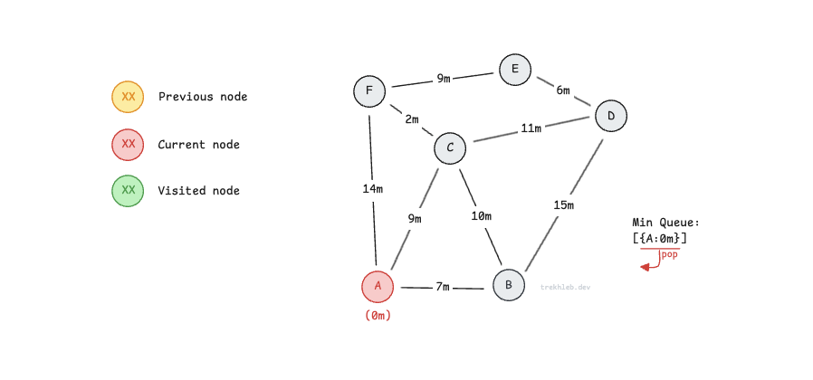

Queue నుంచి తీసిన node యొక్క ప్రతి neighbor దగ్గరికి వెళ్ళి, origin నుంచి దానికి distance లెక్కపెడతాం. ఉదాహరణకి `A` నుంచి `B` కి distance `0m + 7m = 7m`, అలా అన్నమాట.

ఇంకా చూడని neighbor ని visit చేసిన ప్రతిసారి, దాన్ని priority queue లో కలుపుతాం. ఇక్కడ priority అంటే origin node నుంచి ఆ neighbor node కి ఉన్న distance.

Node `B` ని తర్వాత traverse చేయడానికి min priority queue లో కలుపుతున్నాం.

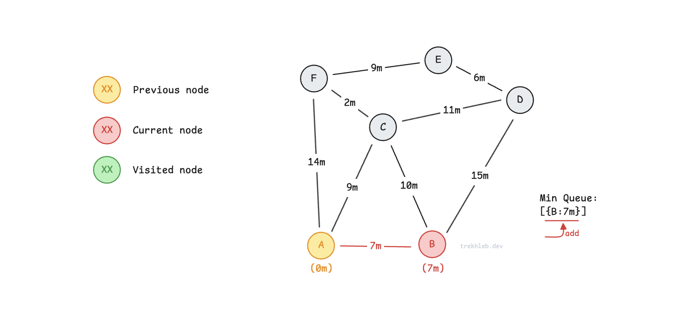

ఇప్పుడు node `A` యొక్క next neighbor `C` ని visit చేస్తున్నాం. Origin node `A` నుంచి `C` కి distance `0m + 9m = 9m`.

Node `C` ని తర్వాత traverse చేయడానికి min priority queue లో కలుపుతున్నాం.

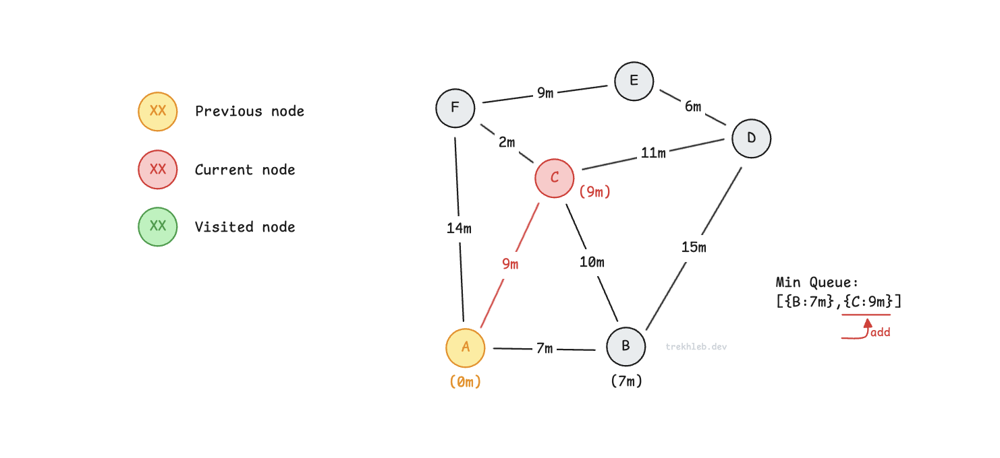

Node `F` కి కూడా అంతే. Origin node `A` నుంచి `F` కి ఇప్పటి distance `0m + 14m = 14m`.

Node `F` ని తర్వాత traverse చేయడానికి min priority queue లో కలుపుతున్నాం.

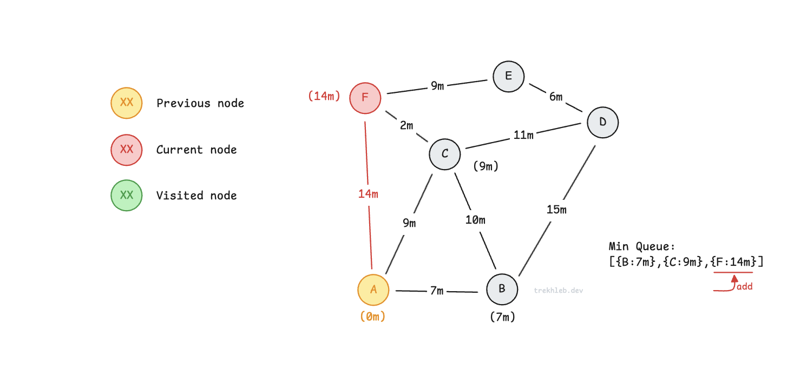

ఇప్పటి node యొక్క neighbors అన్నీ చెక్ చేసేశాక, ఆ node ని `visited` set లో కలుపుతాం. తర్వాత traversals లో ఇలాంటి nodes ని మళ్ళీ visit చేయకూడదు.

ఇప్పుడు priority queue నుంచి origin కి అతి దగ్గరగా ఉన్న (తక్కువ distance ఉన్న) next node ని బయటికి తీద్దాం. దాని neighbors ని కూడా visit చేయడం మొదలుపెడదాం.

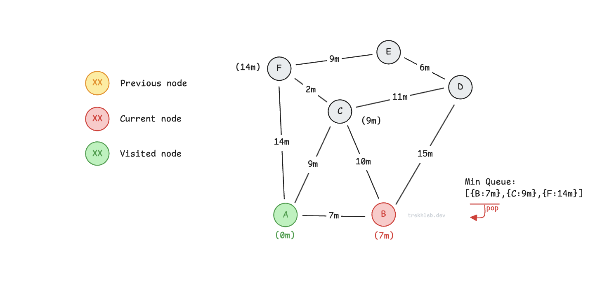

మనం visit చేస్తున్న node (ఇక్కడ node `C`) ఇప్పటికే queue లో ఉంటే, దానికి distance ఇంతకుముందే లెక్కపెట్టాం అని అర్థం — కానీ వేరే node/path (`A → C`) నుంచి. ఇప్పుడు (current neighbor node `A → B → C` నుంచి) వచ్చే distance ఇంతకుముందు లెక్కపెట్టినదానికంటే తక్కువ ఉంటే, (priority queue లో) distance ని తక్కువదానికి update చేస్తాం, ఎందుకంటే మనం shortest paths కోసమే వెతుకుతున్నాం. ఒకవేళ current neighbor నుంచి వచ్చే distance ఎక్కువగా ఉంటే, queue లో `C` node distance ని update చేయకుండా అలాగే వదిలేస్తాం.

Node `C` ని `B` గుండా (path `A → B → C`) visit చేసేటప్పుడు, distance `7m + 10m = 17m` వస్తుంది. ఇది path `A → C` కి ఇప్పటికే రికార్డ్ చేసిన `9m` కంటే ఎక్కువ. ఇలాంటప్పుడు ఎక్కువ distance ని పట్టించుకోము, priority (ఆ టైమ్ కి origin node నుంచి దొరికిన minimum distance) ని update చేయము.

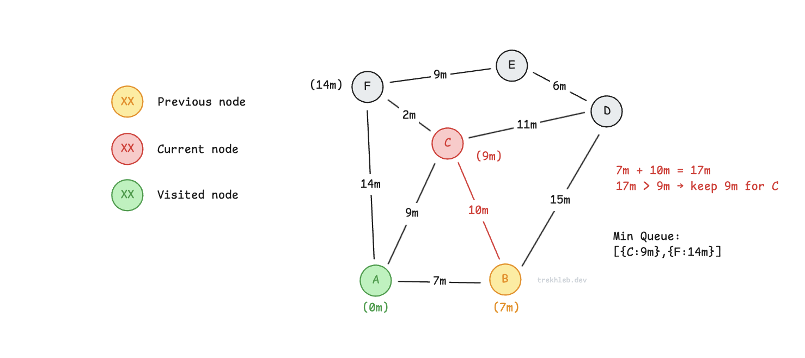

ఇప్పుడు `B` యొక్క ఇంకో neighbor `D` ని visit చేస్తున్నాం. `D` కి distance `7m + 15m = 22m`. `D` ని ఇంకా visit చేయలేదు, అది min priority queue లో కూడా లేదు కాబట్టి, దాన్ని `22m` priority (distance) తో queue లో కలిపేద్దాం.

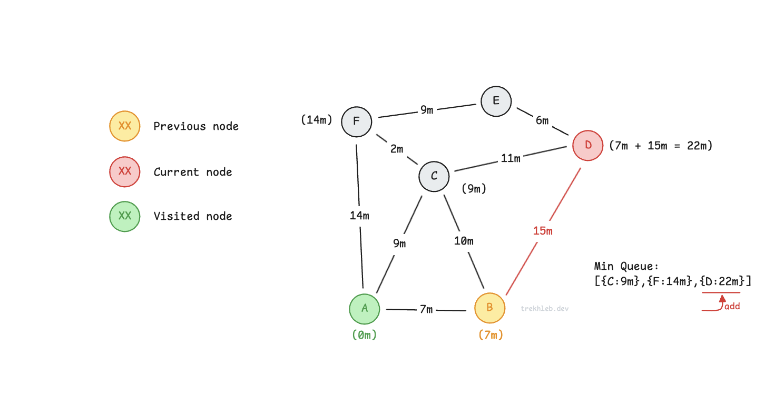

ఇప్పటికి `B` యొక్క neighbors అందరినీ traverse చేసేశాం, కాబట్టి `B` ని `visited` set లో కలుపుతాం. తర్వాత, priority queue నుంచి origin node కి అతి దగ్గరగా ఉన్న node ని తీస్తాం.

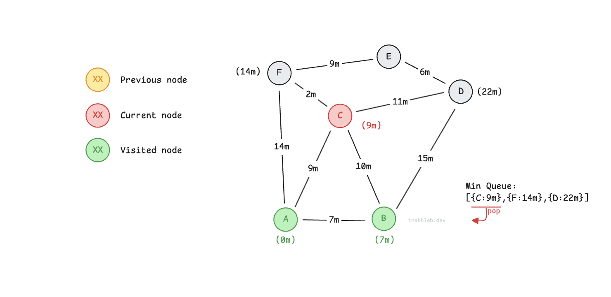

Node `C` యొక్క unvisited neighbors ని traverse చేస్తున్నాం. `C` గుండా (path `A → C → F`) node `F` కి distance `9m + 2m = 11m`. ఇది ఇంతకుముందు రికార్డ్ చేసిన `A → F` path యొక్క `14m` కంటే తక్కువ. ఇలాంటప్పుడు `F` కి distance ని `11m` గా update చేసి, queue లో దాని priority ని `14m` నుంచి `11m` కి మారుస్తాం. `F` కి ఇంకా చిన్న path దొరికింది.

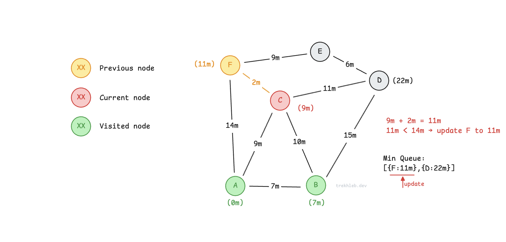

`D` కి కూడా అంతే. `D` కి ఇంకా చిన్న path దొరికింది — `A → C → D` అనేది `A → B → D` కంటే చిన్నది. Distance ని `22m` నుంచి `20m` కి update చేస్తున్నాం.

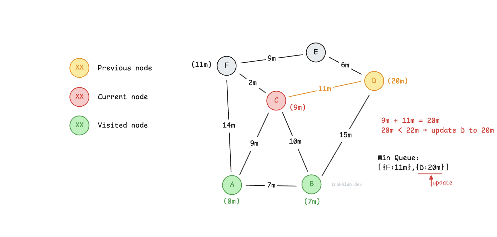

`C` యొక్క neighbors అందరినీ traverse చేసేశాం, కాబట్టి `C` ని `visited` set లో కలపొచ్చు. Queue నుంచి next దగ్గరి node ని తీస్తున్నాం, అది `F`.

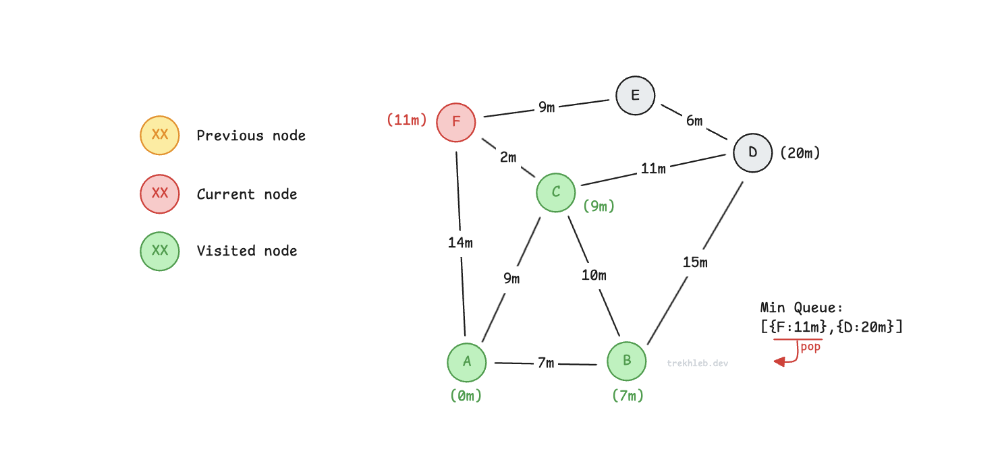

`E` కి distance ని `11m + 9m = 20m` గా రికార్డ్ చేస్తున్నాం.

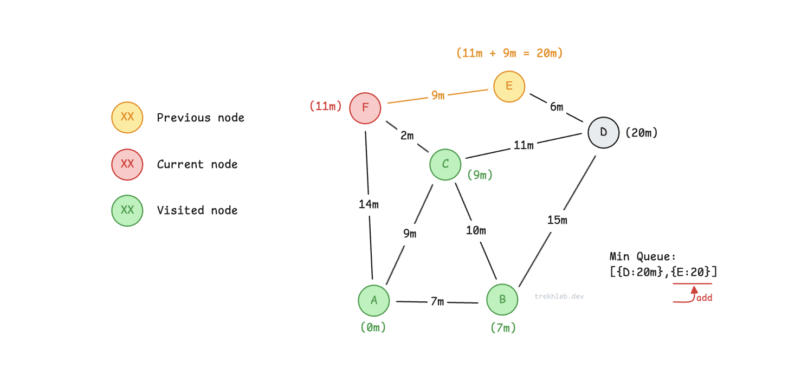

Node `F` ని `visited` set లో కలిపి, queue నుంచి next దగ్గరి node `D` ని తీస్తున్నాం.

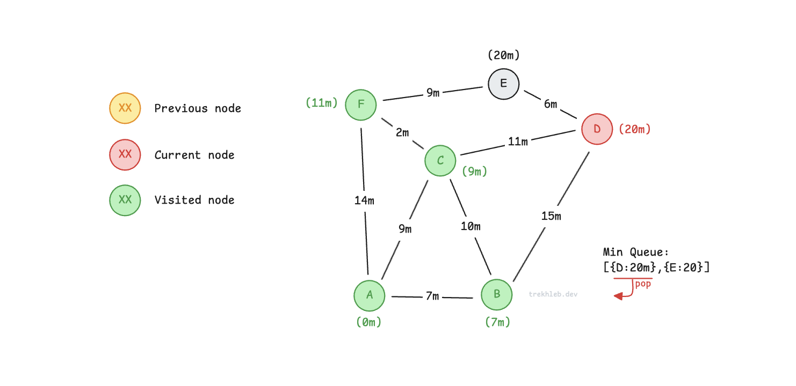

`D` గుండా `E` కి distance `20m + 6m = 26m`. ఇది `F` నుంచి `E` కి ఇప్పటికే లెక్కపెట్టిన `20m` కంటే ఎక్కువ. ఎక్కువ distance ని వదిలేయొచ్చు.

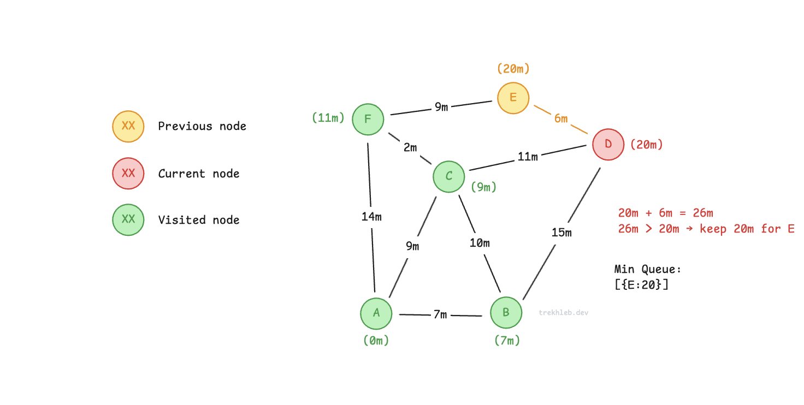

ఇప్పుడు node `D` visit అయిపోయింది.

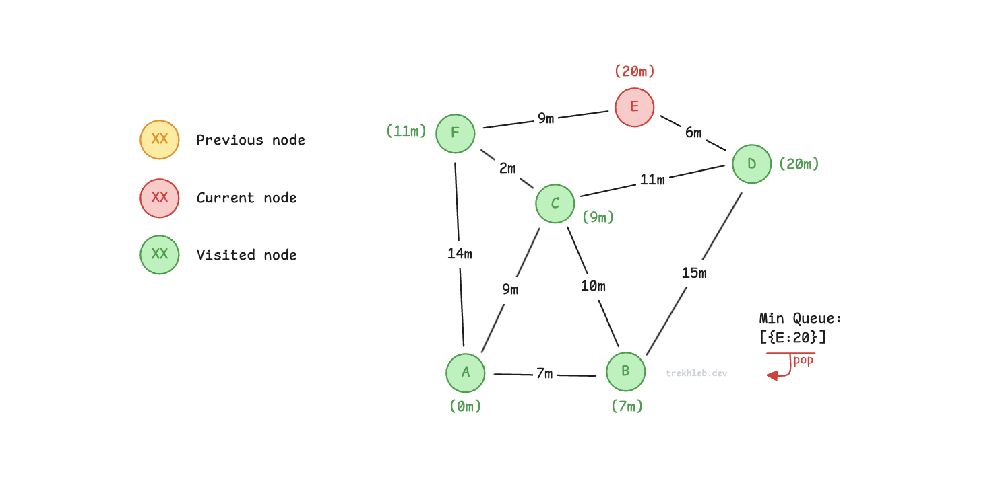

Node `E` కూడా visit అయిపోయింది. Graph traversal అయిపోయింది.

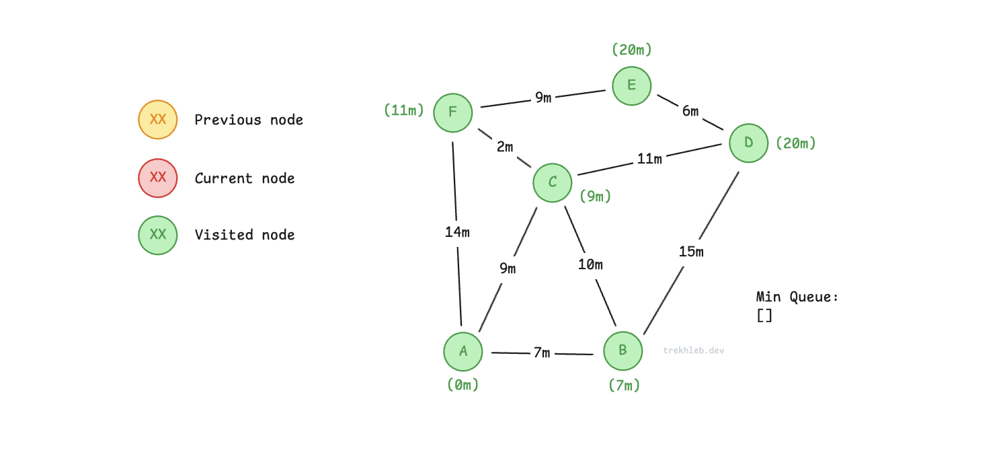

ఇప్పుడు start node `A` నుంచి ప్రతి node కి shortest distances మనకి తెలుసు.

నిజంగా implement చేసేటప్పుడు, distances లెక్కపెడుతూనే ప్రతి node కి `previousVertices` ని కూడా రికార్డ్ చేస్తాం — దాంతో shortest path ఏ nodes వరుసలో వెళ్తుందో exact గా చూపించొచ్చు.

ఉదాహరణకి, `A` నుంచి `E` కి shortest path `A → C → F → E`.

## Implementation example

- [dijkstra.js](./dijkstra.js)

## References

- [Wikipedia](https://en.wikipedia.org/wiki/Dijkstra%27s_algorithm)
- [YouTube లో Nathaniel Fan](https://www.youtube.com/watch?v=gdmfOwyQlcI&list=PLLXdhg_r2hKA7DPDsunoDZ-Z769jWn4R8)
- [YouTube లో Tushar Roy](https://www.youtube.com/watch?v=lAXZGERcDf4&list=PLLXdhg_r2hKA7DPDsunoDZ-Z769jWn4R8)
