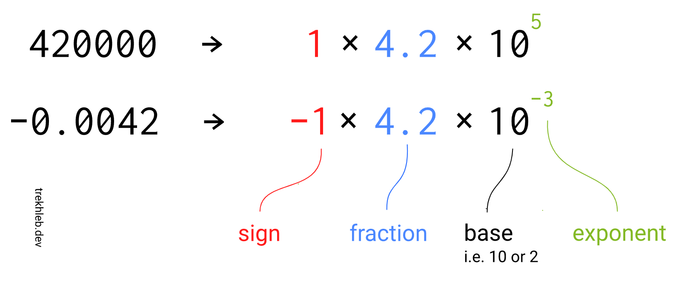
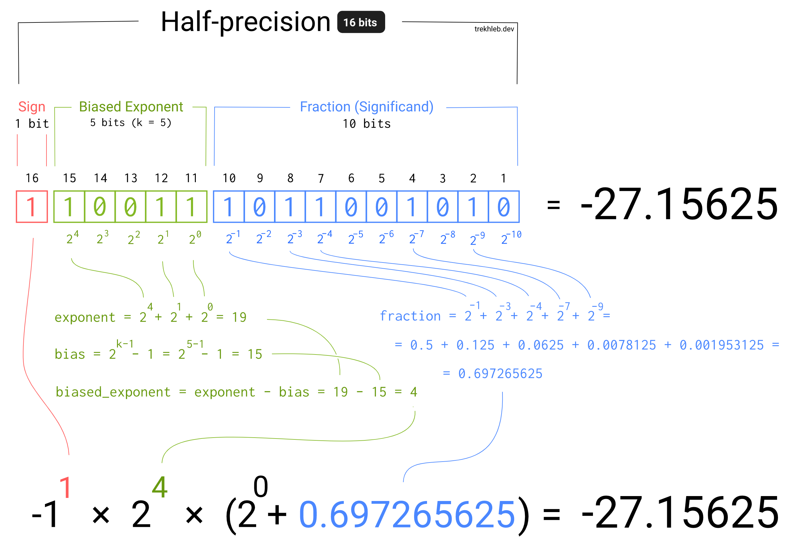

# Floating-point numbers యొక్క Binary representation

_వేరే భాషల్లో చదవాలంటే:_
[_English_](README.md)

Computers `3.1416` (𝝿) లేదా `9.109 × 10⁻³¹` (electron mass, kg లో) లాంటి floating-point numbers ని memory లో ఎలా store చేస్తాయో ఎప్పుడైనా ఆలోచించారా? Memory లో ఉండేది లిమిటెడ్ సంఖ్యలో ones, zeroes (అంటే bits) మాత్రమే కదా?

Integers (ఉదాహరణకి `17`) కి అయితే ఇది చాలా ఈజీగా అనిపిస్తుంది. నంబర్ store చేయడానికి మన దగ్గర 16 bits (2 bytes) ఉన్నాయి అనుకుందాం. 16 bits లో `[0, 65535]` range లో ఉన్న integers store చేయొచ్చు:

```text
(0000000000000000)₂ = (0)₁₀

(0000000000010001)₂ =
    (1 × 2⁴) +
    (0 × 2³) +
    (0 × 2²) +
    (0 × 2¹) +
    (1 × 2⁰) = (17)₁₀

(1111111111111111)₂ =
    (1 × 2¹⁵) +
    (1 × 2¹⁴) +
    (1 × 2¹³) +
    (1 × 2¹²) +
    (1 × 2¹¹) +
    (1 × 2¹⁰) +
    (1 × 2⁹) +
    (1 × 2⁸) +
    (1 × 2⁷) +
    (1 × 2⁶) +
    (1 × 2⁵) +
    (1 × 2⁴) +
    (1 × 2³) +
    (1 × 2²) +
    (1 × 2¹) +
    (1 × 2⁰) = (65535)₁₀
```

Signed integer (negative నంబర్లు కూడా) కావాలంటే, [two's complement](https://en.wikipedia.org/wiki/Two%27s_complement) వాడి `[0, 65535]` range ని negative నంబర్ల వైపు జరపొచ్చు. అప్పుడు మన 16 bits `[-32768, +32767]` range లో నంబర్లని చూపిస్తాయి.

మీరు గమనించే ఉంటారు — ఈ పద్ధతిలో `-27.15625` లాంటి నంబర్లని చూపించలేం (decimal point తర్వాత ఉన్న నంబర్లని వదిలేస్తాం).

ఈ problem ని గమనించింది మనం మొదటివాళ్ళం కాదు లెండి. దాదాపు ≈36 సంవత్సరాల క్రితం కొంతమంది తెలివైనవాళ్ళు floating-point arithmetic కోసం [IEEE 754](https://en.wikipedia.org/wiki/IEEE_754) standard తీసుకొచ్చి ఈ limitation ని దాటారు.

IEEE 754 standard ఆ 16 bits (లేదా 32, లేదా 64 bits) ని వాడి ఇంకా పెద్ద range లో నంబర్లని — చిన్న floating numbers (1 కంటే చిన్నవి, 0 కి దగ్గరగా ఉన్నవి) తో సహా — ఎలా store చేయాలో చెప్పే పద్ధతి (framework).

ఈ standard వెనక ఐడియా అర్థమవ్వడానికి [scientific notation](https://en.wikipedia.org/wiki/Scientific_notation) గుర్తుచేసుకోవచ్చు — decimal form లో రాయడానికి కష్టంగా ఉండే మరీ పెద్ద లేదా మరీ చిన్న నంబర్లని (మామూలుగా రాస్తే చాలా పొడవైన digits వస్తాయి) చూపించే పద్ధతి అది.



Image లో చూస్తే, నంబర్ ని మూడు భాగాలుగా విడగొట్టొచ్చు:

- **sign**
- **fraction (దీన్నే significand అంటారు)** - నంబర్ లో విలువైన digits (అసలు అర్థం, payload)
- **exponent** - fraction లో decimal point ని ఎంత దూరం, ఏ వైపుకి జరపాలో చెప్తుంది

**Base** భాగం ఎంత అనేది ముందే ఒప్పుకుంటే దాన్ని వదిలేయొచ్చు. మన case లో base గా `2` వాడతాం.

మొత్తం 16 bits (లేదా 32 bits, లేదా 64 bits) ని నంబర్ fraction store చేయడానికే వాడకుండా, bits ని పంచుకుని sign, exponent, fraction మూడూ ఒకేసారి store చేయొచ్చు. నంబర్ store చేయడానికి ఎన్ని bits వాడతాం అనేదాన్ని బట్టి ఈ పంపకాలు వస్తాయి:

| Floating-point format | మొత్తం bits | Sign bits | Exponent bits | Fraction bits | Base |
| :-------------------- | :--------: | :-------: | :-----------: | :--------------: | :--: |
| [Half-precision](https://en.wikipedia.org/wiki/Half-precision_floating-point_format)        | 16         | 1         | 5             | 10               | 2    |
| [Single-precision](https://en.wikipedia.org/wiki/Single-precision_floating-point_format)      | 32         | 1         | 8             | 23               | 2    |
| [Double-precision](https://en.wikipedia.org/wiki/Double-precision_floating-point_format)      | 64         | 1         | 11            | 52               | 2    |

ఈ పద్ధతిలో fraction కి bits తగ్గాయి (ఉదాహరణకి 16-bits నంబర్ కి 16 bits నుంచి 10 bits కి తగ్గింది). అంటే ఇప్పుడు fraction చిన్న range values మాత్రమే తీసుకోగలదు (కొంత precision పోతుంది). కానీ exponent భాగం కూడా ఉంది కాబట్టి, మొత్తం నంబర్ range నిజానికి పెరుగుతుంది, ఇంకా 0, 1 మధ్య నంబర్లని కూడా చూపించొచ్చు (exponent negative అయితే).

> ఉదాహరణకి, signed 32-bit integer variable maximum value 2³¹ − 1 = 2,147,483,647, కానీ IEEE 754 32-bit base-2 floating-point variable maximum value ≈ 3.4028235 × 10³⁸.

Exponent negative కూడా అవ్వడానికి, IEEE 754 standard [biased exponent](https://en.wikipedia.org/wiki/Exponent_bias) వాడుతుంది. ఐడియా సింపుల్ — exponent value నుంచి bias ని తీసేస్తే అది negative అవ్వొచ్చు. ఉదాహరణకి, exponent కి 5 bits ఉంటే, అది `[0, 31]` range లో values తీసుకోవచ్చు (ఇక్కడ అన్నీ positive). కానీ దాని నుంచి `15` తీసేస్తే, range `[-15, 16]` అవుతుంది. ఈ `15` నంబర్ ని bias అంటారు, దాన్ని ఈ formula తో లెక్కపెడతారు:

```
exponent_bias = 2 ^ (k−1) − 1

k - number of exponent bits
```

(ఇక్కడ `k` అంటే exponent bits సంఖ్య.)

Floating-point numbers ని binary format నుంచి మళ్ళీ decimal format కి మార్చే logic ని కింద image లో చూపించడానికి ట్రై చేశాను. IEEE 754 standard ఎలా పనిచేస్తుందో దీంతో ఇంకా బాగా అర్థమవుతుందని ఆశిస్తున్నాను. సింపుల్ గా ఉండటానికి ఇక్కడ 16-bits నంబర్ వాడాం, కానీ 32-bits, 64-bits నంబర్లకి కూడా ఇదే పద్ధతి పనిచేస్తుంది.



> Bits ని on/off చేసి, final result మీద అది ఎలా ఎఫెక్ట్ చూపిస్తుందో చూడాలంటే [ఈ diagram interactive version](https://trekhleb.dev/blog/2021/binary-floating-point/) చూడండి

వేరువేరు floating-point formats support చేసే నంబర్ ranges ఇవి:

| Floating-point format | Exp min | Exp max | Range            | Min positive |
| :-------------------- | :------ | :------ | :--------------- | :----------- |
| Half-precision        | −14     | +15     | ±65,504          | 6.10 × 10⁻⁵  |
| Single-precision      | −126    | +127    | ±3.4028235 × 10³⁸| 1.18 × 10⁻³⁸ |

గుర్తుపెట్టుకోండి — ఇది IEEE 754 standard గురించి పూర్తి overview ఏమాత్రం కాదు. ఇది సింపుల్ గా, బేసిక్ గా ఇచ్చిన overview. సింపుల్ గా ఉండటానికి పైన examples లో కొన్ని corner cases వదిలేశాం (ఉదాహరణకి `-0`, `-∞`, `+∞`, `NaN` (not a number) values)

## Code examples

- Bits array ని floating point number గా ఎలా మార్చాలో example కోసం [bitsToFloat.js](bitsToFloat.js) చూడండి (example కొంచెం కృత్రిమంగా ఉంటుంది కానీ conversion ఎలా జరుగుతుందో overview ఇస్తుంది)
- JavaScript లో floating-point number యొక్క అసలు binary representation ఎలా చూడాలో example కోసం [floatAsBinaryString.js](floatAsBinaryString.js) చూడండి

## References

Floating-point numbers binary representation గురించి ఇంకా లోతుగా అర్థం చేసుకోవాలంటే ఇవి కూడా చూడొచ్చు:

- [ఈ article interactive version](https://trekhleb.dev/blog/2021/binary-floating-point/) (bits ని మీరే set చేసి వచ్చే floating number చూడొచ్చు)
- [JavaScript Number type గురించి మీకు తెలియాల్సింది ఇదే](https://indepth.dev/posts/1139/here-is-what-you-need-to-know-about-javascripts-number-type)
- [Float Exposed](https://float.exposed/)
- [IEEE754 Visualization](https://bartaz.github.io/ieee754-visualization/)
