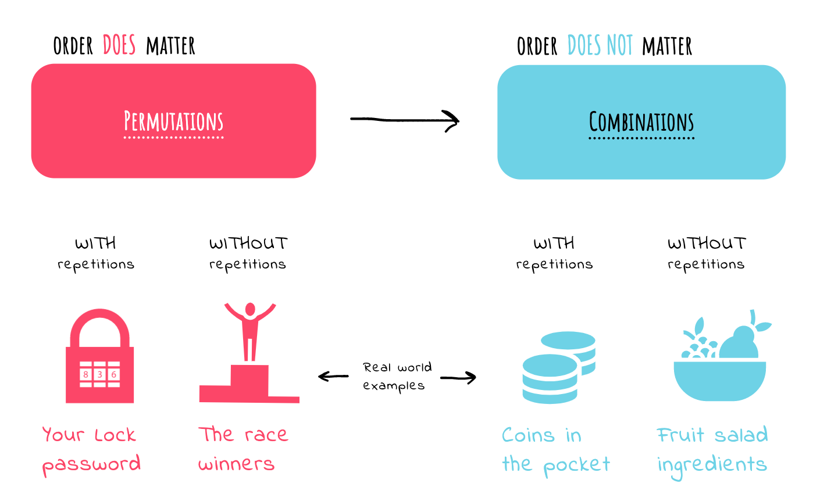
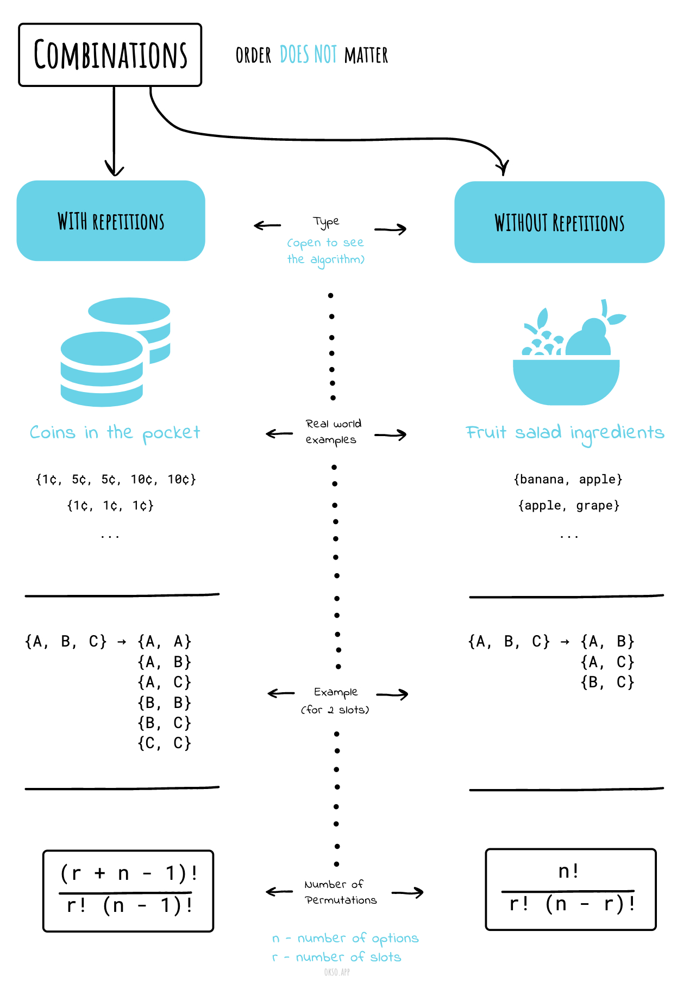
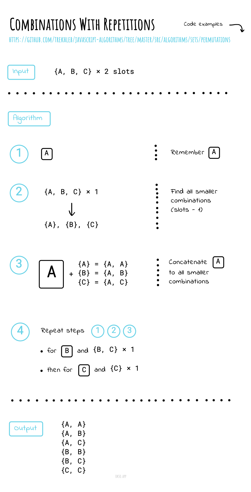
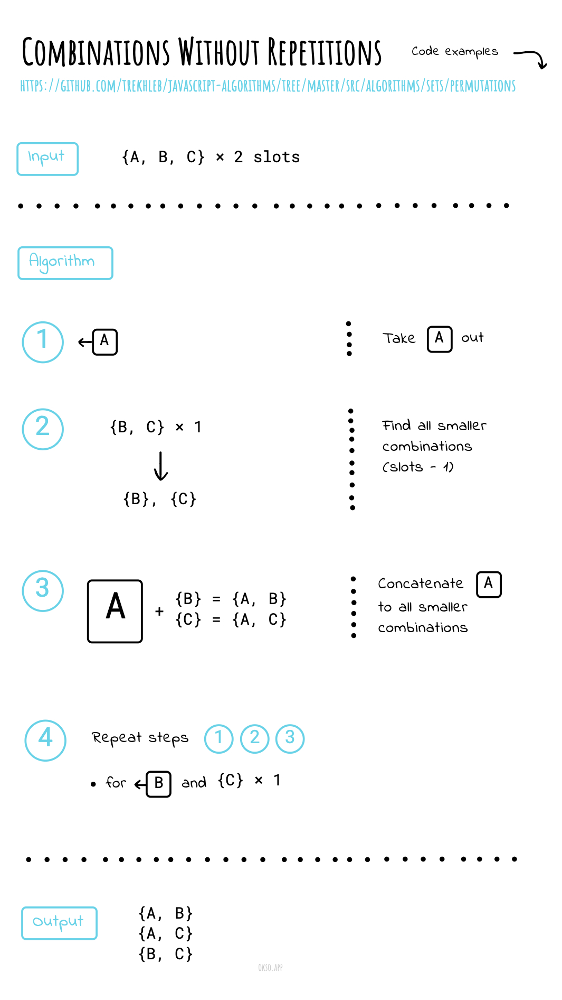

# Combinations

_వేరే భాషల్లో చదవాలంటే:_
[_English_](README.md)

Order (వరుస) ముఖ్యం కాకపోతే, అది **Combination**.

Order **ముఖ్యం** అయితే, అది **Permutation**.

**"నా fruit salad లో apples, grapes, bananas కలిపి ఉన్నాయి"**
Fruits ఏ order లో ఉన్నాయో మనం పట్టించుకోము — "bananas, grapes, apples" అయినా,
"grapes, apples, bananas" అయినా, అది అదే fruit salad.

## Repetition లేని Combinations

Lotteries ఇలాగే పనిచేస్తాయి. Numbers ని ఒక్కొక్కటిగా తీస్తారు, మన దగ్గర lucky numbers ఉంటే
(ఏ order లో అయినా సరే) మనం గెలుస్తాం!

Repetition లేదు: lottery numbers లాగా `(2,14,15,27,30,33)`

**Combinations సంఖ్య**

ఇక్కడ `n` అంటే ఎంచుకోడానికి ఉన్న వస్తువుల సంఖ్య, అందులో `r` ఎంచుకుంటాం,
repetition లేదు, order ముఖ్యం కాదు.

దీన్ని మామూలుగా "n choose r" అంటారు (ఉదాహరణకి "16 choose 3"). దీన్నే Binomial Coefficient అని కూడా అంటారు.

## Repetition ఉన్న Combinations

Repetition కుదురుతుంది: మీ జేబులో ఉన్న coins లాగా `(5,5,5,10,10)`

లేదా ఐదు ice cream flavours ఉన్నాయి అనుకుందాం:
`banana`, `chocolate`, `lemon`, `strawberry`, `vanilla`.

మనం మూడు scoops తీసుకోవచ్చు. ఎన్ని రకాలుగా తీసుకోవచ్చు?

Flavours కి letters వాడదాం: `{b, c, l, s, v}`.
కొన్ని ఉదాహరణలు:

- `{c, c, c}` (chocolate 3 scoops)
- `{b, l, v}` (banana, lemon, vanilla ఒక్కోటి)
- `{b, v, v}` (banana ఒకటి, vanilla రెండు)

**Combinations సంఖ్య**

ఇక్కడ `n` అంటే ఎంచుకోడానికి ఉన్న వస్తువుల సంఖ్య, అందులో `r` ఎంచుకుంటాం.
Repetition కుదురుతుంది, order ముఖ్యం కాదు.

## Cheatsheet

| | |
| --- | --- |
| |  |

*[okso.app](https://okso.app) తో తయారుచేశారు*

## References

- [Math Is Fun](https://www.mathsisfun.com/combinatorics/combinations-permutations.html)
- [Permutations/combinations cheat sheets](https://medium.com/@trekhleb/permutations-combinations-algorithms-cheat-sheet-68c14879aba5)
