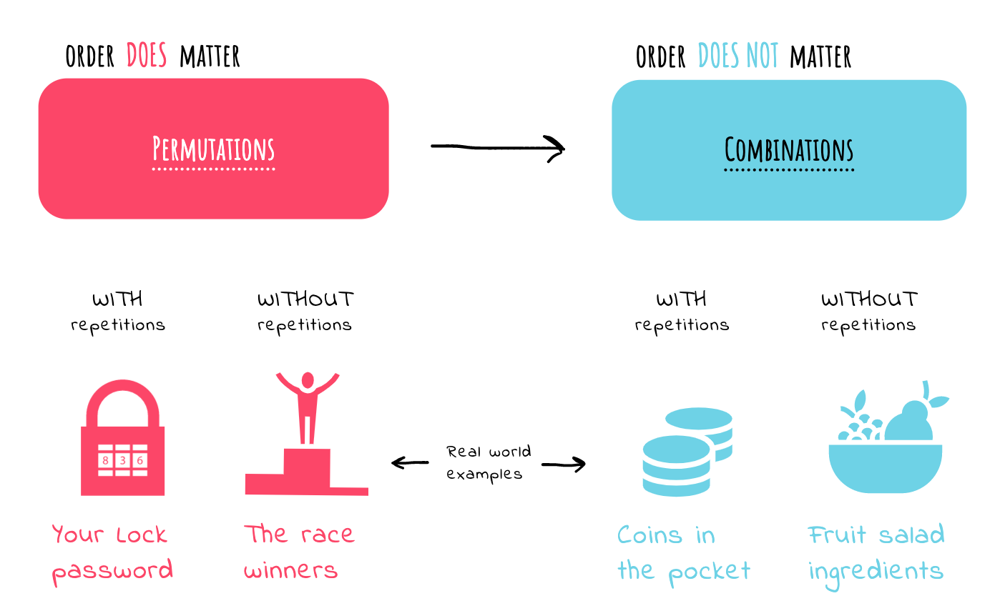
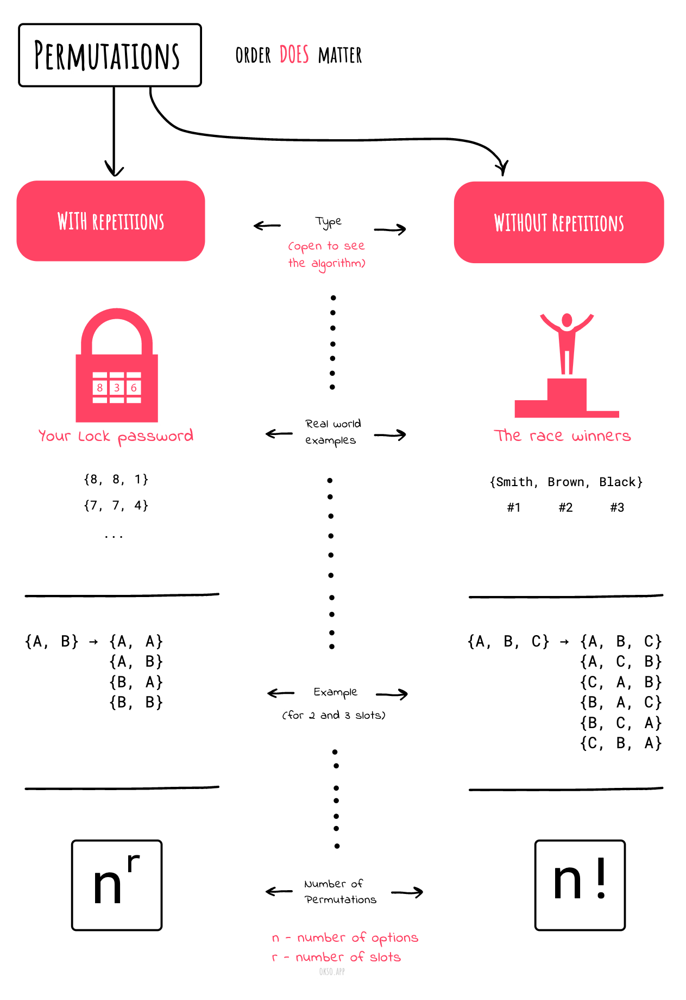
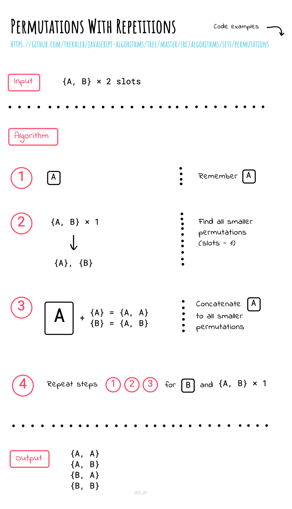
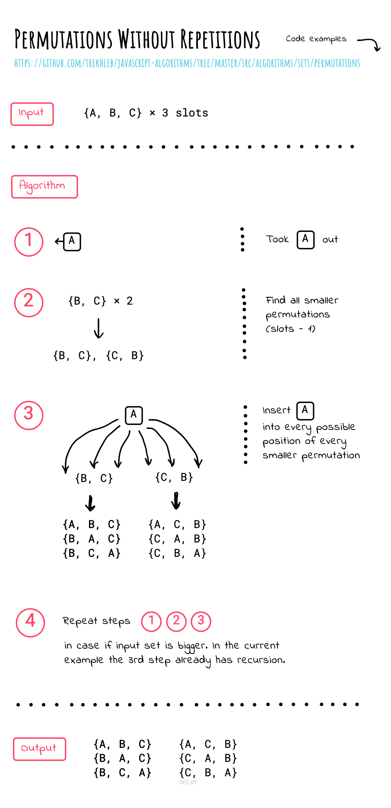

# Permutations

_వేరే భాషల్లో చదవాలంటే:_
[_English_](README.md)

Order (వరుస) ముఖ్యం కాకపోతే, అది **Combination**.

Order **ముఖ్యం** అయితే, అది **Permutation**.

**"Safe (తిజోరీ) తెరవడానికి combination 472"**. ఇక్కడ order మనకి ముఖ్యం. `724` పనిచేయదు, `247` కూడా పనిచేయదు.
అది సరిగ్గా `4-7-2` నే అయి ఉండాలి.

## Repetition లేని Permutations

Permutation ("arrangement number" లేదా "order" అని కూడా అంటారు) అంటే ఒక ordered list `S` లో
elements ని మళ్ళీ వేరే వరుసలో పెట్టడం — `S` తోనే ఒకదానికొకటి (one-to-one) సరిపోయేలా.

String `ABC` యొక్క permutations ఇవి.

`ABC ACB BAC BCA CBA CAB`

లేదా ఉదాహరణకి running race లో మొదటి ముగ్గురు: మీరు first, second రెండూ అవ్వలేరు కదా.

**Combinations సంఖ్య**

```
n * (n-1) * (n -2) * ... * 1 = n!
```

## Repetition ఉన్న Permutations

Repetition కుదిరితే, అవి repetition ఉన్న permutations.
ఉదాహరణకి, కింద ఉన్న lock నంబర్ `333` కూడా కావొచ్చు.


**Combinations సంఖ్య**

```
n * n * n ... (r times) = n^r
```

## Cheatsheet





| | |
| --- | --- |
| |  |

*[okso.app](https://okso.app) తో తయారుచేశారు*

## References

- [Math Is Fun](https://www.mathsisfun.com/combinatorics/combinations-permutations.html)
- [Permutations/combinations cheat sheets](https://medium.com/@trekhleb/permutations-combinations-algorithms-cheat-sheet-68c14879aba5)
