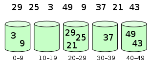
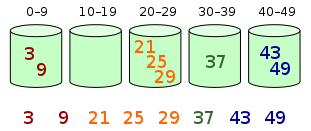

# Bucket Sort

_వేరే భాషల్లో చదవాలంటే:_
[_English_](README.md)

**Bucket sort** (లేదా **bin sort**) అనేది ఒక array లో elements ని కొన్ని buckets (బకెట్లు) లోకి పంచి పనిచేసే sorting algorithm. తర్వాత ప్రతి bucket ని విడిగా sort చేస్తారు — వేరే sorting algorithm తో గానీ, లేదా bucket sorting algorithm నే మళ్ళీ recursive గా వాడి గానీ.

## Algorithm

Bucket sort ఇలా పనిచేస్తుంది:

1. మొదట్లో ఖాళీగా ఉన్న `buckets` array ఒకటి తయారుచేయండి.
2. **Scatter (పంచడం):** Original array మీద వెళ్తూ, ప్రతి object ని దాని `bucket` లో పెట్టండి.
3. ఖాళీగా లేని ప్రతి `bucket` ని sort చేయండి.
4. **Gather (పోగుచేయడం):** `buckets` ని వరుసగా visit చేసి, అన్ని elements ని మళ్ళీ original array లో పెట్టండి.

Elements ని bins లోకి పంచుతారు:

తర్వాత, ప్రతి bin లోపల elements ని sort చేస్తారు:

## Complexity

Computational complexity మూడు విషయాల మీద ఆధారపడి ఉంటుంది — ప్రతి bucket ని sort చేయడానికి వాడే algorithm, ఎన్ని buckets వాడతాం, ఇంకా input సమానంగా పంచబడి (uniformly distributed) ఉందా లేదా.

Bucket మీద వాడే sorting algorithm *insertion sort* అయితే, bucket sort **worst-case** time complexity
`O(n^2)`. ఎక్కువగా అదే వాడతారు, ఎందుకంటే మొత్తం list తో పోలిస్తే buckets లో మరీ ఎక్కువ elements ఉండవు అని అనుకుంటాం. Worst case లో అన్ని elements ఒకే bucket లో పడతాయి, అప్పుడు running time insertion sort worst-case complexity కి (అన్ని elements తిరగబడిన order లో ఉన్నప్పుడు) పడిపోతుంది. మధ్యలో వాడే sort యొక్క worst-case running time `O(n * log(n))` అయితే, bucket sort worst-case running time కూడా `O(n * log(n))` అవుతుంది.

**Average** గా, buckets లోకి elements దాదాపు సమానంగా పంచబడితే, `k` buckets కి bucket sort average గా `O(n + k)` లో రన్ అవుతుంది అని చూపించొచ్చు.

## References

- [Wikipedia లో Bucket Sort](https://en.wikipedia.org/wiki/Bucket_sort)
