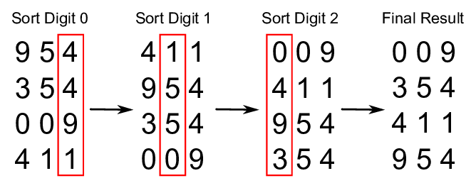

# Radix Sort

_వేరే భాషల్లో చదవాలంటే:_
[_English_](README.md),
[_Português_](README.pt-BR.md)

Computer science లో **radix sort** అనేది compare చేయకుండా పనిచేసే (non-comparative) integer sorting
algorithm. Integer keys ఉన్న data ని, ఒకే significant position లో ఒకే value ఉన్న digits ని బట్టి
keys ని groups గా చేసి sort చేస్తుంది. దీనికి positional notation కావాలి, కానీ integers తో characters
strings (ఉదాహరణకి పేర్లు లేదా dates) ని, ప్రత్యేకంగా format చేసిన floating point numbers ని కూడా
చూపించొచ్చు కాబట్టి, radix sort integers కి మాత్రమే పరిమితం కాదు.

*ఈ పేరు ఎక్కడి నుంచి వచ్చింది?*

Mathematical numeral systems లో, *radix* లేదా base అంటే positional numeral system లో నంబర్లని
చూపించడానికి వాడే unique digits సంఖ్య (zero digit తో సహా). ఉదాహరణకి, binary system (0, 1 నంబర్లు
వాడేది) radix 2, decimal system (0 నుంచి 9 వరకు నంబర్లు వాడేది) radix 10.

## Efficiency

వేరే sorting algorithms తో పోలిస్తే radix sort ఎంత efficient అనే విషయం కొంచెం tricky, దీని గురించి
చాలా అపార్థాలు ఉన్నాయి. బెస్ట్ comparison-based algorithms తో పోలిస్తే radix sort సమానంగా efficient
ఆ, తక్కువ efficient ఆ, ఎక్కువ efficient ఆ అనేది — మనం ఏం అనుకుంటున్నాం (assumptions) అనేదాని
details మీద ఆధారపడి ఉంటుంది. Word size `w` ఉన్న integers అయిన `n` keys కి radix sort complexity
`O(wn)`. కొన్నిసార్లు `w` ని ఒక constant గా చూపిస్తారు — అలా అయితే radix sort (`n` సరిపోయేంత పెద్దగా
ఉన్నప్పుడు) బెస్ట్ comparison-based sorting algorithms కంటే బెటర్ అవుతుంది, ఎందుకంటే అవన్నీ `n` keys
sort చేయడానికి `O(n log n)` comparisons చేస్తాయి. కానీ, జనరల్ గా `w` ని constant గా చూడలేం: `n` keys
అన్నీ వేరువేరుగా ఉంటే, random-access machine వాటిని memory లో store చేయాలంటే `w` కనీసం `log n` ఉండాలి,
దాంతో బెస్ట్ అయినా time complexity `O(n log n)` వస్తుంది. అంటే radix sort మహా అయితే బెస్ట్
comparison-based sorts తో సమానంగా efficient గా ఉంటుంది అనిపిస్తుంది (keys `log n` కంటే చాలా
పొడవుగా ఉంటే ఇంకా worse).

## Complexity

| పేరు                  | Best            | Average             | Worst               | Memory    | Stable    | Comments  |
| --------------------- | :-------------: | :-----------------: | :-----------------: | :-------: | :-------: | :-------- |
| **Radix sort**        | n * k           | n * k               | n * k               | n + k     | అవును     | k - అతి పొడవైన key యొక్క length |

## References

- [Wikipedia](https://en.wikipedia.org/wiki/Radix_sort)
- [YouTube](https://www.youtube.com/watch?v=XiuSW_mEn7g&index=62&t=0s&list=PLLXdhg_r2hKA7DPDsunoDZ-Z769jWn4R8)
- [ResearchGate](https://www.researchgate.net/figure/Simplistic-illustration-of-the-steps-performed-in-a-radix-sort-In-this-example-the_fig1_291086231)
