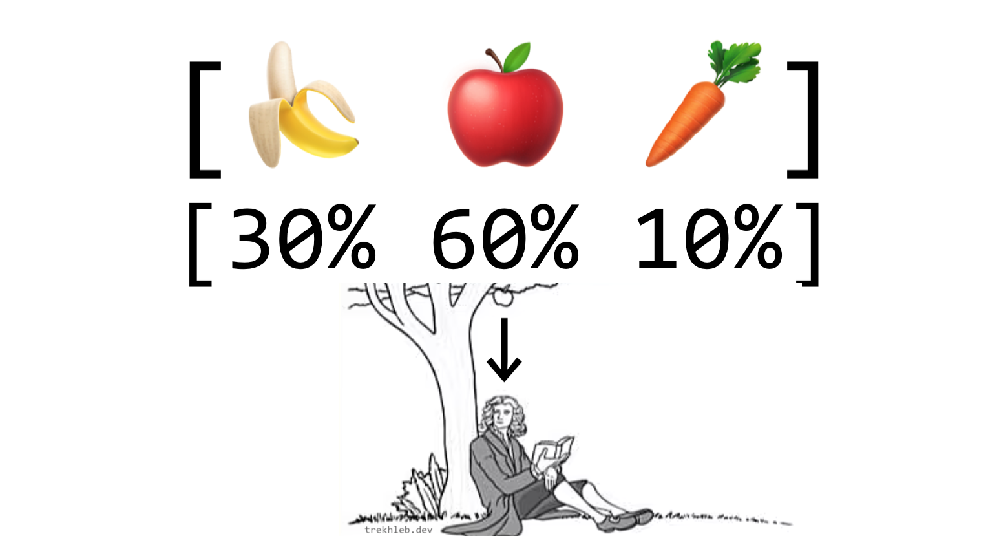

# Weighted Random

_వేరే భాషల్లో చదవాలంటే:_
[_English_](README.md)



## "Weighted Random" అంటే ఏంటి

మీ దగ్గర **items** list ఒకటి ఉంది అనుకుందాం. Item ఏదైనా కావొచ్చు. ఉదాహరణకి, మీకు తినడానికి ఇష్టమైన fruits, vegetables list: `[ '🍌', '🍎', '🥕' ]`.

**Weights** list ప్రతి item యొక్క weight (లేదా probability, లేదా ఎంత ముఖ్యం) ని చూపిస్తుంది. Weights అంటే నంబర్లు. ఉదాహరణకి, `[3, 7, 1]` లాంటి weights ఇలా చెప్తాయి:

- మీరు `🍎 apples` ఎక్కువసార్లు తినాలనుకుంటారు (`3 + 7 + 1 = 11` సార్లలో `7` సార్లు),
- `bananas 🍌` తక్కువసార్లు తినాలనుకుంటారు (`11` సార్లలో `3` సార్లు మాత్రమే),
- ఇంకా `carrots 🥕` మీకు అస్సలు ఇష్టం లేదు (`11` సార్లలో `1` సారి మాత్రమే తినాలనుకుంటారు).

> Probabilities పరంగా మాట్లాడితే, weights list అనేది మొత్తం `1` వచ్చే floats array కావొచ్చు (ఉదాహరణకి `[0.1, 0.5, 0.2, 0.2]`).

ఇక్కడ **Weighted Random** అంటే list నుంచి random గా ఒక item ఇచ్చే function — కానీ ప్రతి item weight ని లెక్కలోకి తీసుకుంటుంది, కాబట్టి ఎక్కువ weight ఉన్న items ఎక్కువసార్లు వస్తాయి.

Function interface example:

```javascript
const items =   [ '🍌', '🍎', '🥕' ];
const weights = [  3,    7,    1  ];

function weightedRandom(items, weights) {
  // implementation goes here ...
}

const nextSnackToEat = weightedRandom(items, weights); // Could be '🍎'
```

## Weighted Random ని ఎక్కడ వాడతారు

- [Genetic Algorithm](https://en.wikipedia.org/wiki/Genetic_algorithm) లో "Selection" phase లో weighted random వాడతారు — తర్వాత ఇంకా బలమైన generation తయారుచేయడానికి, fitness score ని బట్టి అతి fit/బలమైన individuals ని ఎంచుకోవాల్సినప్పుడు. [500 Lines of Code లో Self-Parking Car](https://trekhleb.dev/blog/2021/self-parking-car-evolution/) article లో ఒక **example** చూడొచ్చు.
- [Recurrent Neural Networks (RNN)](https://en.wikipedia.org/wiki/Recurrent_neural_network) లో, next letter probability ని బట్టి (sentence తయారుచేయడానికి) next ఏ letter ఎంచుకోవాలో నిర్ణయించేటప్పుడు. [Recurrent Neural Network (RNN) తో Recipe Generation](https://nbviewer.org/github/trekhleb/machine-learning-experiments/blob/master/experiments/recipe_generation_rnn/recipe_generation_rnn.ipynb) Jupyter notebook లో ఒక **example** చూడొచ్చు.
- [Nginx Load Balancing](https://docs.nginx.com/nginx/admin-guide/load-balancer/http-load-balancer/) లో, ఎక్కువ weights ఉన్న servers కి HTTP requests ఎక్కువసార్లు పంపడానికి.
- ఇంకా చాలా...

## Algorithm

**డైరెక్ట్ పద్ధతి** ఇది:

1. List లో ప్రతి item ని దాని weight అన్నిసార్లు రిపీట్ చేయండి.
2. List నుంచి random గా ఒక item ఎంచుకోండి.

ఉదాహరణకి మన fruits, vegetables case లో `3 + 7 + 1 = 11` సైజ్ ఉన్న ఈ list తయారుచేయొచ్చు:

```javascript
const items =   [ '🍌', '🍎', '🥕' ];
const weights = [  3,    7,    1  ];

// Repeating the items based on weights.
const weightedItems = [
  '🍌', '🍌', '🍌',
  '🍎', '🍎', '🍎', '🍎', '🍎', '🍎', '🍎',
  '🥕',
];

// And now just pick the random item from weightedItems array.
```

కానీ, చూడొచ్చు — `weightedItems` list లో రిపీట్ చేయాల్సిన items చాలా ఉంటే, ఈ పద్ధతికి చాలా memory కావాలి. `"some-random-string"` (`18` bytes) లాంటి string ని కోటి సార్లు రిపీట్ చేయాలి అనుకోండి. కేవలం ఈ array కోసమే దాదాపు `180Mb` అదనపు memory కేటాయించాలి.

**ఇంకా efficient పద్ధతి** ఇది:

1. ప్రతి item కి cumulative weights (కూడుతూ వెళ్ళే weights) list తయారుచేయండి (అంటే original `weights` list లో ఎన్ని elements ఉన్నాయో అన్నే ఉండే `cumulativeWeights` list). మన case లో అది ఇలా ఉంటుంది: `cumulativeWeights = [3, 3 + 7, 3 + 7 + 1] = [3, 10, 11]`
2. `0` నుంచి అతి పెద్ద cumulative weight value వరకు ఒక random నంబర్ `randomNumber` తయారుచేయండి. మన case లో random నంబర్ `[0..11]` range లో ఉంటుంది. `randomNumber = 8` వచ్చింది అనుకుందాం.
3. `cumulativeWeights` list మీద ఎడమ నుంచి కుడికి వెళ్తూ, `randomNumber` కంటే ఎక్కువ లేదా సమానంగా ఉన్న మొదటి element ని ఎంచుకోండి. ఆ element index తో `items` array నుంచి item తీసుకుంటాం.

ఈ పద్ధతి వెనక ఐడియా ఏంటంటే — ఎక్కువ weights ఎక్కువ నంబర్ల స్థలాన్ని "ఆక్రమిస్తాయి". కాబట్టి random నంబర్ "ఎక్కువ weight ఉన్న నంబర్ల bucket" లో పడే chance ఎక్కువ.

```javascript
const weights =           [3, 7,  1 ];
const cumulativeWeights = [3, 10, 11];

// In a pseudo-representation we may think about the cumulativeWeights array like this.
const pseudoCumulativeWeights = [
  1, 2, 3,               // <-- [3] numbers
  4, 5, 6, 7, 8, 9, 10,  // <-- [7] numbers
  11,                    // <-- [1] number
];
```

`weightedRandom` function ని ఎలా implement చేయొచ్చో example ఇది:

```javascript
/**
 * Picks the random item based on its weight.
 * The items with higher weight will be picked more often (with a higher probability).
 *
 * For example:
 * - items = ['banana', 'orange', 'apple']
 * - weights = [0, 0.2, 0.8]
 * - weightedRandom(items, weights) in 80% of cases will return 'apple', in 20% of cases will return
 * 'orange' and it will never return 'banana' (because probability of picking the banana is 0%)
 *
 * @param {any[]} items
 * @param {number[]} weights
 * @returns {{item: any, index: number}}
 */
export default function weightedRandom(items, weights) {
  if (items.length !== weights.length) {
    throw new Error('Items and weights must be of the same size');
  }

  if (!items.length) {
    throw new Error('Items must not be empty');
  }

  // Preparing the cumulative weights array.
  // For example:
  // - weights = [1, 4, 3]
  // - cumulativeWeights = [1, 5, 8]
  const cumulativeWeights = [];
  for (let i = 0; i < weights.length; i += 1) {
    cumulativeWeights[i] = weights[i] + (cumulativeWeights[i - 1] || 0);
  }

  // Getting the random number in a range of [0...sum(weights)]
  // For example:
  // - weights = [1, 4, 3]
  // - maxCumulativeWeight = 8
  // - range for the random number is [0...8]
  const maxCumulativeWeight = cumulativeWeights[cumulativeWeights.length - 1];
  const randomNumber = maxCumulativeWeight * Math.random();

  // Picking the random item based on its weight.
  // The items with higher weight will be picked more often.
  for (let itemIndex = 0; itemIndex < items.length; itemIndex += 1) {
    if (cumulativeWeights[itemIndex] >= randomNumber) {
      return {
        item: items[itemIndex],
        index: itemIndex,
      };
    }
  }
}
```

## Implementation

- `weightedRandom()` function implementation కోసం [weightedRandom.js](weightedRandom.js) file చూడండి.
- Test-cases కోసం [weightedRandom.test.js](__test__/weightedRandom.test.js) file చూడండి.
