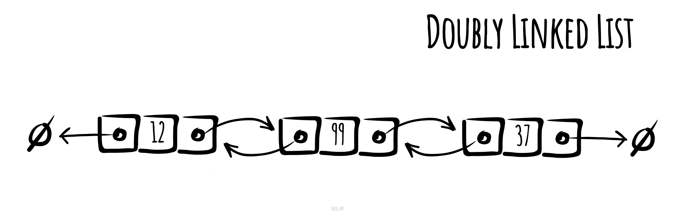

# Doubly Linked List

_వేరే భాషల్లో చదవాలంటే:_
[_English_](README.md),
[_Русский_](README.ru-RU.md),
[_简体中文_](README.zh-CN.md),
[_日本語_](README.ja-JP.md),
[_Português_](README.pt-BR.md),
[_한국어_](README.ko-KR.md),
[_Español_](README.es-ES.md),
[_Українська_](README.uk-UA.md)

Computer science లో **doubly linked list** అనేది ఒక linked data structure — ఇందులో nodes అనే, వరుసగా
link అయిన records set ఉంటుంది. ప్రతి node లో links అనే రెండు fields ఉంటాయి — అవి nodes వరుసలో ముందు
node కి, తర్వాత node కి references. List ని traverse చేయడం ఈజీ అవ్వడానికి, మొదటి node యొక్క previous
link, చివరి node యొక్క next link ఏదో ఒక రకమైన terminator ని point చేస్తాయి — మామూలుగా ఒక sentinel node
గానీ null గానీ. ఒకే ఒక్క sentinel node ఉంటే, ఆ sentinel node ద్వారా list circular గా link అవుతుంది. దీన్ని
అవే data items తో, కానీ ఎదురెదురు వరుసల్లో తయారైన రెండు singly linked lists గా ఊహించుకోవచ్చు.



_[okso.app](https://okso.app) తో తయారుచేశారు_

రెండు node links వల్ల list ని ఏ direction లో అయినా traverse చేయొచ్చు. Doubly linked list లో node కలపడానికి
గానీ తీసేయడానికి గానీ, singly linked list తో పోలిస్తే ఎక్కువ links మార్చాలి — కానీ operations ఇంకా సింపుల్
గా, (మొదటి nodes కాకుండా వేరే nodes కి) ఇంకా ఫాస్ట్ గా ఉండొచ్చు. ఎందుకంటే traverse చేసేటప్పుడు ముందు
node ని ట్రాక్ చేయాల్సిన అవసరం లేదు, లేదా ముందు node link మార్చడానికి దాన్ని వెతుకుతూ list traverse
చేయాల్సిన అవసరం లేదు.

## Basic Operations కి Pseudocode

### Insert

```text
Add(value)
  Pre: value is the value to add to the list
  Post: value has been placed at the tail of the list
  n ← node(value)
  if head = ø
    head ← n
    tail ← n
  else
    n.previous ← tail
    tail.next ← n
    tail ← n
  end if
end Add
```

### Delete

```text
Remove(head, value)
  Pre: head is the head node in the list
       value is the value to remove from the list
  Post: value is removed from the list, true; otherwise false
  if head = ø
    return false
  end if
  if value = head.value
    if head = tail
      head ← ø
      tail ← ø
    else
      head ← head.next
      head.previous ← ø
    end if
    return true
  end if
  n ← head.next
  while n != ø and value !== n.value
    n ← n.next
  end while
  if n = tail
    tail ← tail.previous
    tail.next ← ø
    return true
  else if n != ø
    n.previous.next ← n.next
    n.next.previous ← n.previous
    return true
  end if
  return false
end Remove
```

### Reverse Traversal

```text
ReverseTraversal(tail)
  Pre: tail is the node of the list to traverse
  Post: the list has been traversed in reverse order
  n ← tail
  while n != ø
    yield n.value
    n ← n.previous
  end while
end Reverse Traversal
```

## Complexities

## Time Complexity

| Access | Search | Insertion | Deletion |
| :----: | :----: | :-------: | :------: |
|  O(n)  |  O(n)  |   O(1)    |   O(n)   |

### Space Complexity

O(n)

## References

- [Wikipedia](https://en.wikipedia.org/wiki/Doubly_linked_list)
- [YouTube](https://www.youtube.com/watch?v=JdQeNxWCguQ&t=7s&index=72&list=PLLXdhg_r2hKA7DPDsunoDZ-Z769jWn4R8)
