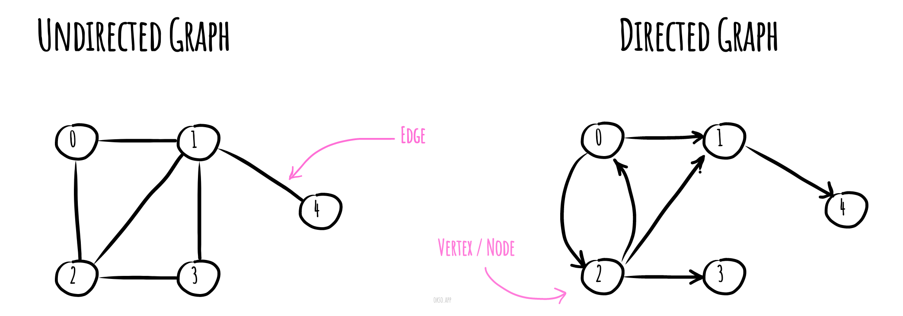

# Graph

_వేరే భాషల్లో చదవాలంటే:_
[_English_](README.md),
[_简体中文_](README.zh-CN.md),
[_Русский_](README.ru-RU.md),
[_Français_](README.fr-FR.md),
[_Português_](README.pt-BR.md),
[_Українська_](README.uk-UA.md)

Computer science లో **graph** అనేది ఒక abstract data type — mathematics లో, ముఖ్యంగా graph theory
లో ఉండే undirected graph, directed graph concepts ని implement చేయడానికి ఇది ఉద్దేశించబడింది.

Graph data structure లో vertices (లేదా nodes లేదా points) ఉన్న ఒక finite (మార్చగలిగే కూడా కావొచ్చు)
set ఉంటుంది. దాంతో పాటు undirected graph అయితే ఈ vertices యొక్క unordered pairs set, directed graph
అయితే ordered pairs set ఉంటుంది. Undirected graph లో ఈ pairs ని edges, arcs, లేదా lines అంటారు;
directed graph లో వాటిని arrows, directed edges, directed arcs, లేదా directed lines అంటారు. Vertices
graph structure లో భాగం కావొచ్చు, లేదా integer indices లేదా references తో సూచించే బయటి entities
కావొచ్చు.

*[okso.app](https://okso.app) తో తయారుచేశారు*

## References

- [Wikipedia](https://en.wikipedia.org/wiki/Graph_(abstract_data_type))
- [YouTube లో Graphs పరిచయం](https://www.youtube.com/watch?v=gXgEDyodOJU&index=9&list=PLLXdhg_r2hKA7DPDsunoDZ-Z769jWn4R8)
- [YouTube లో Graphs representation](https://www.youtube.com/watch?v=k1wraWzqtvQ&index=10&list=PLLXdhg_r2hKA7DPDsunoDZ-Z769jWn4R8)
