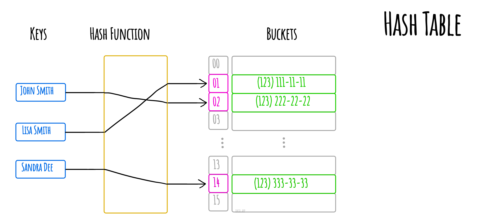
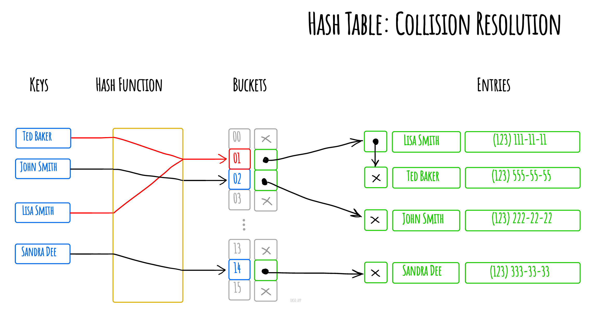

# Hash Table

_వేరే భాషల్లో చదవాలంటే:_
[_English_](README.md),
[_简体中文_](README.zh-CN.md),
[_Русский_](README.ru-RU.md),
[_日本語_](README.ja-JP.md),
[_Français_](README.fr-FR.md),
[_Português_](README.pt-BR.md),
[_한국어_](README.ko-KR.md),
[_Українська_](README.uk-UA.md)

Computing లో **hash table** (hash map) అనేది _associative array_ అనే abstract data type ని implement
చేసే data structure — అంటే _keys ని values కి map చేయగలిగే_ structure. Hash table ఒక _hash function_
వాడి buckets లేదా slots ఉన్న array లో ఒక index లెక్కపెడుతుంది, ఆ index నుంచి మనకి కావాల్సిన value
దొరుకుతుంది.

ఆదర్శంగా, hash function ప్రతి key కి ఒక unique bucket ఇవ్వాలి. కానీ చాలా hash table designs
perfect కాని hash function వాడతాయి — దాంతో hash collisions రావొచ్చు, అంటే hash function ఒకటి కంటే
ఎక్కువ keys కి ఒకే index ఇస్తుంది. ఇలాంటి collisions ని ఏదో ఒక రకంగా handle చేయాలి.

Separate chaining తో hash collision ని పరిష్కరించడం.

_[okso.app](https://okso.app) తో తయారుచేశారు_

## References

- [Wikipedia](https://en.wikipedia.org/wiki/Hash_table)
- [YouTube](https://www.youtube.com/watch?v=shs0KM3wKv8&index=4&list=PLLXdhg_r2hKA7DPDsunoDZ-Z769jWn4R8)
