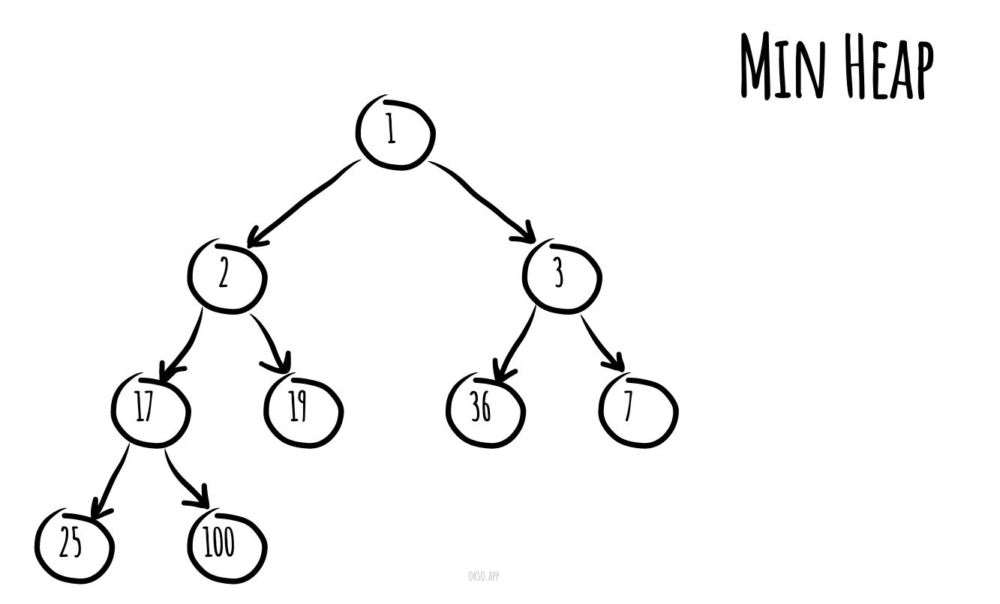
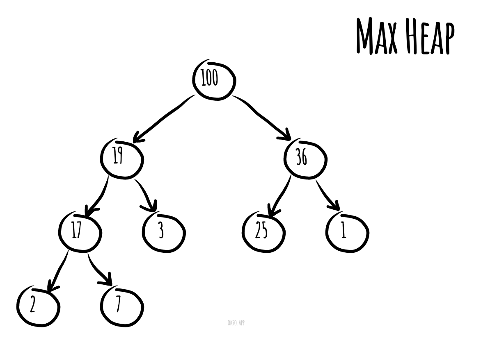
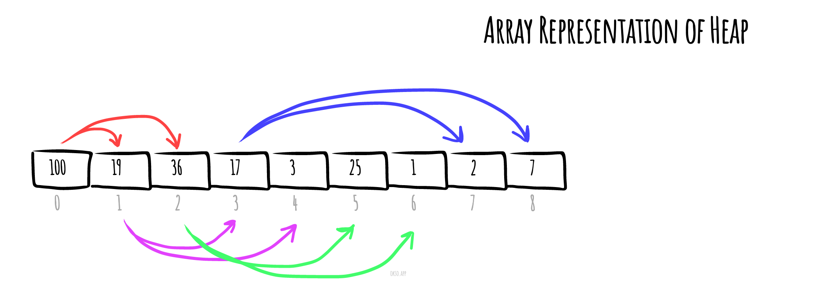

# Heap (data-structure)

_వేరే భాషల్లో చదవాలంటే:_
[_English_](README.md),
[_简体中文_](README.zh-CN.md),
[_Русский_](README.ru-RU.md),
[_日本語_](README.ja-JP.md),
[_Français_](README.fr-FR.md),
[_Português_](README.pt-BR.md),
[_Türkçe_](README.tr-TR.md),
[_한국어_](README.ko-KR.md),
[_Українська_](README.uk-UA.md)

Computer science లో **heap** అనేది tree మీద బేస్ అయిన ఒక ప్రత్యేక data structure — ఇది కింద చెప్పిన
heap property ని పాటిస్తుంది.

*Min heap* లో, `P` అనేది `C` కి parent node అయితే, `P` key (value) ఎప్పుడూ `C` key కంటే తక్కువ లేదా
సమానంగా ఉంటుంది.

*[okso.app](https://okso.app) తో తయారుచేశారు*

*Max heap* లో, `P` key ఎప్పుడూ `C` key కంటే ఎక్కువ లేదా సమానంగా ఉంటుంది

Heap "పైన" ఉండే, parents లేని node ని root node అంటారు.

## Time Complexities

వేరువేరు heap data structures time complexities ఇవి. Function పేర్లు max-heap కోసం అనుకున్నవి.

| Operation | find-max | delete-max | insert| increase-key| meld |
| --------- | -------- | ---------- | ----- | ----------- | ---- |
| [Binary](https://en.wikipedia.org/wiki/Binary_heap) | `Θ(1)` | `Θ(log n)` | `O(log n)` | `O(log n)` | `Θ(n)` |
| [Leftist](https://en.wikipedia.org/wiki/Leftist_tree) | `Θ(1)` | `Θ(log n)` | `Θ(log n)` | `O(log n)` | `Θ(log n)` |
| [Binomial](https://en.wikipedia.org/wiki/Binomial_heap) | `Θ(1)` | `Θ(log n)` | `Θ(1)` | `O(log n)` | `O(log n)` |
| [Fibonacci](https://en.wikipedia.org/wiki/Fibonacci_heap) | `Θ(1)` | `Θ(log n)` | `Θ(1)` | `Θ(1)` | `Θ(1)` |
| [Pairing](https://en.wikipedia.org/wiki/Pairing_heap) | `Θ(1)` | `Θ(log n)` | `Θ(1)` | `o(log n)` | `Θ(1)` |
| [Brodal](https://en.wikipedia.org/wiki/Brodal_queue) | `Θ(1)` | `Θ(log n)` | `Θ(1)` | `Θ(1)` | `Θ(1)` |
| [Rank-pairing](https://en.wikipedia.org/w/index.php?title=Rank-pairing_heap&action=edit&redlink=1) | `Θ(1)` | `Θ(log n)` | `Θ(1)` | `Θ(1)` | `Θ(1)` |
| [Strict Fibonacci](https://en.wikipedia.org/wiki/Fibonacci_heap) | `Θ(1)` | `Θ(log n)` | `Θ(1)` | `Θ(1)` | `Θ(1)` |
| [2-3 heap](https://en.wikipedia.org/wiki/2%E2%80%933_heap) | `O(log n)` | `O(log n)` | `O(log n)` | `Θ(1)` | `?` |

ఇక్కడ:
- **find-max (లేదా find-min):** max-heap లో maximum item ని, లేదా min-heap లో minimum item ని కనుక్కోవడం (దీన్నే *peek* అంటారు)
- **delete-max (లేదా delete-min):** max heap (లేదా min heap) root node ని తీసేయడం
- **insert:** heap లో కొత్త key కలపడం (దీన్నే *push* అంటారు)
- **increase-key లేదా decrease-key:** max- లేదా min-heap లో ఒక key ని update చేయడం
- **meld:** రెండు heaps ని కలిపి, రెండిట్లో ఉన్న అన్ని elements తో ఒక కొత్త valid heap తయారుచేయడం — పాత heaps పోతాయి.

> ఈ repository లో [MaxHeap.js](./MaxHeap.js), [MinHeap.js](./MinHeap.js) అనేవి **Binary** heap కి examples.

## Implementation

- [MaxHeap.js](./MaxHeap.js), [MinHeap.js](./MinHeap.js)
- [MaxHeapAdhoc.js](./MaxHeapAdhoc.js), [MinHeapAdhoc.js](./MinHeapAdhoc.js) - MinHeap/MaxHeap data structure యొక్క చిన్న (ad hoc) version — దీనికి బయటి dependencies ఏమీ లేవు, coding interview లో interviewer ఒప్పుకుంటే ఈజీగా copy-paste చేసి వాడుకోవచ్చు (ఎందుకంటే JS లో చాలా data structures లేవు).

## References

- [Wikipedia](https://en.wikipedia.org/wiki/Heap_(data_structure))
- [YouTube](https://www.youtube.com/watch?v=t0Cq6tVNRBA&index=5&t=0s&list=PLLXdhg_r2hKA7DPDsunoDZ-Z769jWn4R8)
