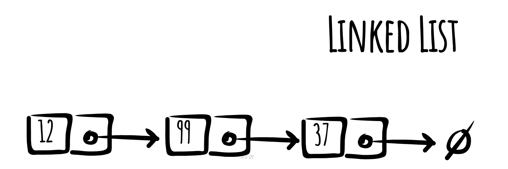

# Linked List

_వేరే భాషల్లో చదవాలంటే:_
[_English_](README.md),
[_简体中文_](README.zh-CN.md),
[_Русский_](README.ru-RU.md),
[_日本語_](README.ja-JP.md),
[_Português_](README.pt-BR.md),
[_한국어_](README.ko-KR.md),
[_Español_](README.es-ES.md),
[_Türkçe_](README.tr-TR.md),
[_Українська_](README.uk-UA.md)

Computer science లో **linked list** అనేది data elements ఉన్న ఒక linear collection — ఇందులో వరుస (linear
order) అనేది memory లో అవి ఎక్కడ ఉన్నాయో దాన్ని బట్టి రాదు. బదులుగా, ప్రతి element తర్వాత element ని
point చేస్తుంది. ఇది కొన్ని nodes ఉన్న data structure, ఆ nodes అన్నీ కలిసి ఒక sequence ని సూచిస్తాయి. అన్నిటికంటే
సింపుల్ రూపంలో, ప్రతి node లో data, ఇంకా sequence లో తర్వాత node కి ఒక reference (అంటే link) ఉంటాయి. ఈ
structure వల్ల iterate చేసేటప్పుడు sequence లో ఏ position నుంచైనా elements ని ఫాస్ట్ గా కలపొచ్చు, తీసేయొచ్చు.
ఇంకా కష్టమైన variants అదనపు links కలుపుతాయి — దాంతో ఏ element reference నుంచైనా ఫాస్ట్ గా కలపొచ్చు,
తీసేయొచ్చు. Linked lists లో ఒక లోపం ఏంటంటే access time linear (pipeline చేయడం కూడా కష్టం). Random access
లాంటి ఫాస్ట్ access కుదరదు. Linked lists తో పోలిస్తే arrays కి cache locality బెటర్ గా ఉంటుంది.



*[okso.app](https://okso.app) తో తయారుచేశారు*

## Basic Operations కి Pseudocode

### Insert

```text
Add(value)
  Pre: value is the value to add to the list
  Post: value has been placed at the tail of the list
  n ← node(value)
  if head = ø
    head ← n
    tail ← n
  else
    tail.next ← n
    tail ← n
  end if
end Add
```

```text
Prepend(value)
 Pre: value is the value to add to the list
 Post: value has been placed at the head of the list
 n ← node(value)
 n.next ← head
 head ← n
 if tail = ø
   tail ← n
 end
end Prepend
```

### Search

```text
Contains(head, value)
  Pre: head is the head node in the list
       value is the value to search for
  Post: the item is either in the linked list, true; otherwise false
  n ← head
  while n != ø and n.value != value
    n ← n.next
  end while
  if n = ø
    return false
  end if
  return true
end Contains
```

### Delete

```text
Remove(head, value)
  Pre: head is the head node in the list
       value is the value to remove from the list
  Post: value is removed from the list, true, otherwise false
  if head = ø
    return false
  end if
  n ← head
  if n.value = value
    if head = tail
      head ← ø
      tail ← ø
    else
      head ← head.next
    end if
    return true
  end if
  while n.next != ø and n.next.value != value
    n ← n.next
  end while
  if n.next != ø
    if n.next = tail
      tail ← n
      tail.next = null
    else
      n.next ← n.next.next
    end if
    return true
  end if
  return false
end Remove
```

### Traverse

```text
Traverse(head)
  Pre: head is the head node in the list
  Post: the items in the list have been traversed
  n ← head
  while n != ø
    yield n.value
    n ← n.next
  end while
end Traverse
```

### Reverse లో Traverse

```text
ReverseTraversal(head, tail)
  Pre: head and tail belong to the same list
  Post: the items in the list have been traversed in reverse order
  if tail != ø
    curr ← tail
    while curr != head
      prev ← head
      while prev.next != curr
        prev ← prev.next
      end while
      yield curr.value
      curr ← prev
    end while
   yield curr.value
  end if
end ReverseTraversal
```

## Complexities

### Time Complexity

| Access    | Search    | Insertion | Deletion  |
| :-------: | :-------: | :-------: | :-------: |
| O(n)      | O(n)      | O(1)      | O(n)      |

### Space Complexity

O(n)

## References

- [Wikipedia](https://en.wikipedia.org/wiki/Linked_list)
- [YouTube](https://www.youtube.com/watch?v=njTh_OwMljA&index=2&t=1s&list=PLLXdhg_r2hKA7DPDsunoDZ-Z769jWn4R8)
