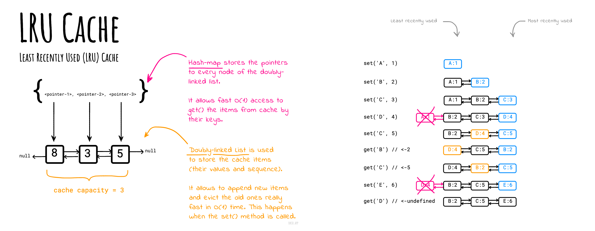

# Least Recently Used (LRU) Cache

_వేరే భాషల్లో చదవాలంటే:_
[_English_](README.md),
[_한국어_](README.ko-KR.md)

**Least Recently Used (LRU) Cache** items ని వాడిన order లో సర్దుతుంది — దాంతో అన్నిటికంటే ఎక్కువ టైమ్ నుంచి ఏ item వాడలేదో ఫాస్ట్ గా కనుక్కోవచ్చు.

ఒక బట్టల stand (rack) ఊహించుకోండి — బట్టలు ఎప్పుడూ ఒక వైపే తగిలిస్తారు. అన్నిటికంటే ముందు వాడిన (least-recently used) item కనుక్కోవాలంటే, rack కి ఇంకో చివర ఉన్న item చూడండి.

## Problem statement

LRUCache class ని implement చేయండి:

- `LRUCache(int capacity)` LRU cache ని **positive** సైజ్ `capacity` తో initialize చేయండి.
- `int get(int key)` `key` ఉంటే దాని value return చేయండి, లేకపోతే `undefined` return చేయండి.
- `void set(int key, int value)` `key` ఉంటే దాని value update చేయండి. లేకపోతే, `key-value` pair ని cache లో కలపండి. ఈ operation వల్ల keys సంఖ్య `capacity` దాటితే, least recently used key ని **బయటికి పంపండి (evict)**.

`get()`, `set()` functions ఒక్కోటి `O(1)` average time complexity లో రన్ అవ్వాలి.

## Implementation

### Version 1: Doubly Linked List + Hash Map

`LRUCache` implementation example కోసం [LRUCache.js](./LRUCache.js) చూడండి. ఈ solution లో cache items ని ఫాస్ట్ గా `O(1)` (average) లో access చేయడానికి `HashMap`, cache items ని ఫాస్ట్ గా `O(1)` (average) లో promote చేయడానికి, బయటికి పంపడానికి (maximum cache capacity దాటకుండా ఉంచడానికి) `DoublyLinkedList` వాడారు.

_[okso.app](https://okso.app) తో తయారుచేశారు_

LRU Cache ఎలా పనిచేస్తుందో ఇంకా test-case examples [LRUCache.test.js](./__test__/LRUCache.test.js) file లో చూడొచ్చు.

### Version 2: Ordered Map

Doubly linked list వాడే మొదటి implementation నేర్చుకోడానికి బాగుంటుంది, ఇంకా `set()`, `get()` చేసేటప్పుడు average `O(1)` time complexity ఎలా వస్తుందో బాగా అర్థమవుతుంది.

కానీ, ఇంకా సింపుల్ పద్ధతి ఏంటంటే JavaScript [Map](https://developer.mozilla.org/en-US/docs/Web/JavaScript/Reference/Global_Objects/Map) object వాడటం. `Map` object key-value pairs ని ఉంచుతుంది, ఇంకా keys ని **ఏ order లో insert చేశామో గుర్తుపెట్టుకుంటుంది**. ఈ విషయాన్ని వాడుకుని, items ని తీసేసి మళ్ళీ కలుపుతూ, recently-used items ని map "చివర్లో" ఉంచొచ్చు. Cache capacity దాటితే `Map` మొదట్లో ఉన్న item నే ముందు బయటికి పోతుంది. Items order ని `map.keys()` లాంటి `IterableIterator` తో చెక్ చేయొచ్చు.

`LRUCacheOnMap` implementation example కోసం [LRUCacheOnMap.js](./LRUCacheOnMap.js) చూడండి.

LRU Cache ఎలా పనిచేస్తుందో ఇంకా test-case examples [LRUCacheOnMap.test.js](./__test__/LRUCacheOnMap.test.js) file లో చూడొచ్చు.

## Complexities

|          | Average |
| -------- | ------- |
| Space    | `O(n)`  |
| Get item | `O(1)`  |
| Set item | `O(1)`  |

## References

- [LeetCode లో LRU Cache](https://leetcode.com/problems/lru-cache/solutions/244744/lru-cache/)
- [InterviewCake లో LRU Cache](https://www.interviewcake.com/concept/java/lru-cache)
- [Wiki లో LRU Cache](https://en.wikipedia.org/wiki/Cache_replacement_policies)
