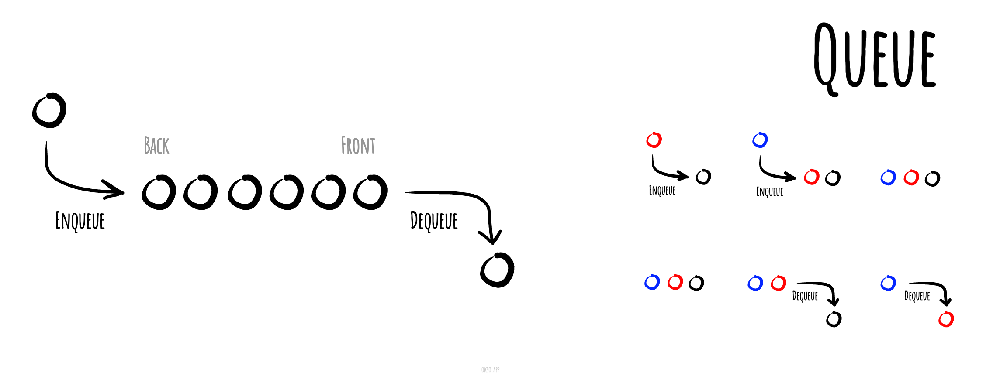

# Queue

_వేరే భాషల్లో చదవాలంటే:_
[_English_](README.md),
[_简体中文_](README.zh-CN.md),
[_Русский_](README.ru-RU.md),
[_日本語_](README.ja-JP.md),
[_Français_](README.fr-FR.md),
[_Português_](README.pt-BR.md),
[_한국어_](README.ko-KR.md),
[_Українська_](README.uk-UA.md)

Computer science లో **queue** (క్యూ / వరుస) అనేది ఒక ప్రత్యేక రకమైన abstract data type లేదా collection.
ఇందులో entities ని order లో ఉంచుతారు, ఇంకా collection మీద ముఖ్యమైన (లేదా ఒకే) operations ఏంటంటే —
వెనక చివరికి entities కలపడం (దీన్ని enqueue అంటారు), ముందు చివర నుంచి entities తీసేయడం (దీన్ని
dequeue అంటారు). అందుకే queue ని First-In-First-Out (FIFO) data structure అంటారు. FIFO data structure
లో, queue లో మొదట కలిపిన element నే మొదట తీసేస్తారు. అంటే ఒక కొత్త element కలిపాక, ఆ కొత్త element ని
తీసేయాలంటే, దానికంటే ముందు కలిపిన elements అన్నీ ముందే తీసేయాలి. చాలాసార్లు peek లేదా front అనే
operation కూడా ఉంటుంది — ఇది ముందు ఉన్న element ని తీసేయకుండా దాని value ఇస్తుంది. Queue అనేది
linear data structure కి, లేదా ఇంకా abstract గా చెప్పాలంటే sequential collection కి ఒక ఉదాహరణ.

సినిమా టికెట్ల క్యూ లాగే — ముందు వచ్చిన వాళ్ళకే ముందు టికెట్.

FIFO (first in, first out) queue ని ఇలా చూపించొచ్చు

*[okso.app](https://okso.app) తో తయారుచేశారు*

## References

- [Wikipedia](https://en.wikipedia.org/wiki/Queue_(abstract_data_type))
- [YouTube](https://www.youtube.com/watch?v=wjI1WNcIntg&list=PLLXdhg_r2hKA7DPDsunoDZ-Z769jWn4R8&index=3&)
