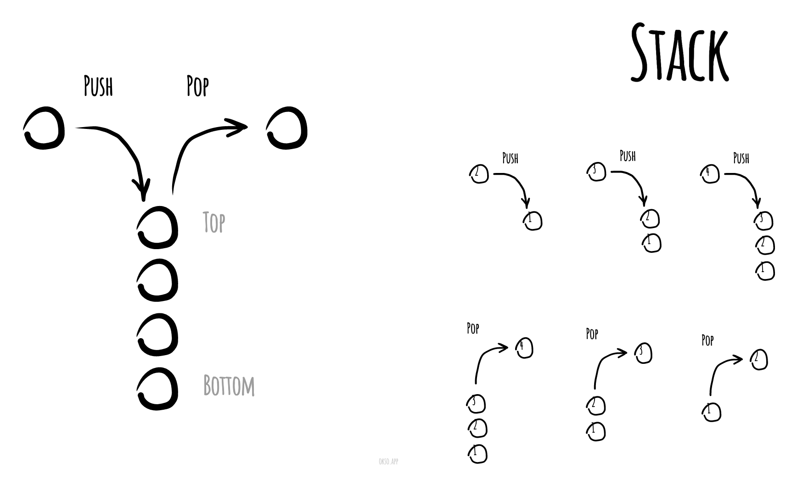

# Stack

_వేరే భాషల్లో చదవాలంటే:_
[_English_](README.md),
[_简体中文_](README.zh-CN.md),
[_Русский_](README.ru-RU.md),
[_日本語_](README.ja-JP.md),
[_Français_](README.fr-FR.md),
[_Português_](README.pt-BR.md),
[_한국어_](README.ko-KR.md),
[_Українська_](README.uk-UA.md)

Computer science లో **stack** అనేది elements collection గా పనిచేసే ఒక abstract data type, దీనికి రెండు
ముఖ్యమైన operations ఉంటాయి:

* **push** — collection లో ఒక element కలుపుతుంది, ఇంకా
* **pop** — ఇంకా తీసేయని elements లో అన్నిటికంటే చివరగా కలిపిన element ని తీసేస్తుంది.

Stack నుంచి elements బయటికి వచ్చే order వల్లే దీనికి LIFO (last in, first out — చివర వచ్చింది ముందు
పోతుంది) అనే ఇంకో పేరు వచ్చింది. అదనంగా, peek operation stack ని మార్చకుండా పైన ఉన్న దాన్ని
చూపిస్తుంది. ఈ రకమైన structure కి "stack" అనే పేరు, ఒకదానిమీద ఒకటి పేర్చిన వస్తువుల నుంచి వచ్చింది —
అలా పేర్చినప్పుడు పైన ఉన్న వస్తువుని తీయడం ఈజీ, కానీ stack లో లోతుగా ఉన్న వస్తువుని తీయాలంటే ముందు
పైన ఉన్న చాలా వస్తువులని తీయాల్సి రావొచ్చు.

ఒకదానిమీద ఒకటి పేర్చిన ప్లేట్ల లాగే — చివరగా పెట్టిన ప్లేటే ముందు తీస్తాం.

Push, pop operations తో stack runtime ని సింపుల్ గా ఇలా చూపించొచ్చు.

*[okso.app](https://okso.app) తో తయారుచేశారు*

## References

- [Wikipedia](https://en.wikipedia.org/wiki/Stack_(abstract_data_type))
- [YouTube](https://www.youtube.com/watch?v=wjI1WNcIntg&list=PLLXdhg_r2hKA7DPDsunoDZ-Z769jWn4R8&index=3&)
