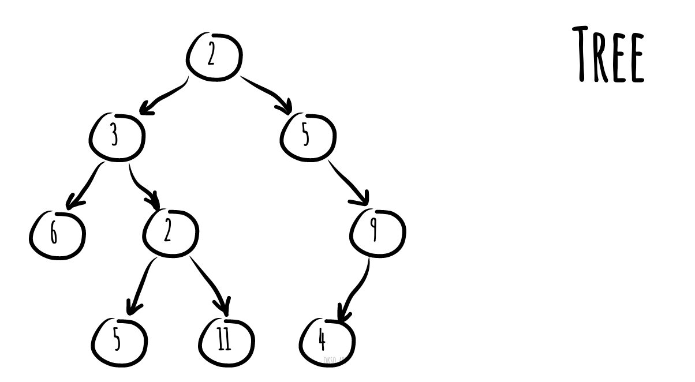

# Tree

_వేరే భాషల్లో చదవాలంటే:_
[_English_](README.md),
[_简体中文_](README.zh-CN.md),
[_Português_](README.pt-BR.md)

* [Binary Search Tree](binary-search-tree)
* [AVL Tree](avl-tree)
* [Red-Black Tree](red-black-tree)
* [Segment Tree](segment-tree) - min/max/sum range queries examples తో
* [Fenwick Tree](fenwick-tree) (Binary Indexed Tree)

Computer science లో **tree** అనేది బాగా వాడే abstract data type (ADT) — లేదా ఈ ADT ని implement చేసే
data structure. ఇది ఒక hierarchical (అంచెలంచెలుగా ఉండే) చెట్టు structure లాగా పనిచేస్తుంది — ఒక root value,
ఇంకా parent node కింద children subtrees ఉంటాయి, వీటిని linked nodes set గా చూపిస్తారు.

Tree data structure ని recursive గా (locally) ఇలా define చేయొచ్చు — nodes collection (root node నుంచి
మొదలయ్యేది), ఇందులో ప్రతి node ఒక value, ఇంకా nodes కి references list ("children") ఉన్న data structure.
Conditions ఏంటంటే — ఏ reference కూడా రెండుసార్లు ఉండకూడదు, ఏదీ root ని point చేయకూడదు.

ఒక సింపుల్ unordered tree; ఈ diagram లో, 3 అని label ఉన్న node కి 2, 6 అని label ఉన్న ఇద్దరు children,
2 అని label ఉన్న ఒక parent ఉన్నారు. పైన ఉన్న root node కి parent లేదు.

*[okso.app](https://okso.app) తో తయారుచేశారు*

## References

- [Wikipedia](https://en.wikipedia.org/wiki/Tree_(data_structure))
- [YouTube](https://www.youtube.com/watch?v=oSWTXtMglKE&list=PLLXdhg_r2hKA7DPDsunoDZ-Z769jWn4R8&index=8)
