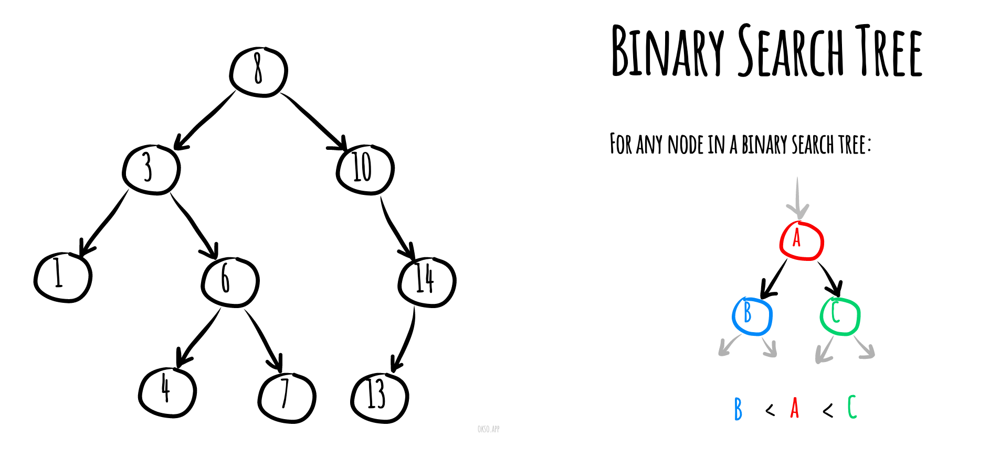

# Binary Search Tree

_వేరే భాషల్లో చదవాలంటే:_
[_English_](README.md),
[_Português_](README.pt-BR.md)

Computer science లో **binary search trees** (BST) — కొన్నిసార్లు ordered లేదా sorted binary trees అని
కూడా అంటారు — అనేవి ఒక ప్రత్యేక రకమైన container: memory లో "items" (numbers, పేర్లు లాంటివి) store
చేసే data structures. ఇవి items ని ఫాస్ట్ గా వెతకడానికి, కలపడానికి, తీసేయడానికి ఉపయోగపడతాయి, ఇంకా
items dynamic sets ని గానీ, key తో item కనుక్కునే lookup tables ని గానీ (ఉదాహరణకి, పేరు తో ఒక వ్యక్తి phone
number కనుక్కోవడం) implement చేయడానికి వాడొచ్చు.

Binary search trees తమ keys ని sorted order లో ఉంచుతాయి — దాంతో lookup, ఇంకా వేరే operations binary
search సూత్రాన్ని వాడుకోవచ్చు: tree లో ఒక key కోసం (లేదా కొత్త key పెట్టడానికి చోటు కోసం) వెతికేటప్పుడు,
root నుంచి leaf వరకు tree ని traverse చేస్తాయి — tree nodes లో store అయిన keys తో compare చేస్తూ, ఆ
compare ని బట్టి left subtree లో వెతకాలా right subtree లో వెతకాలా నిర్ణయిస్తాయి. Average గా, ప్రతి compare
తో tree లో దాదాపు సగం skip అవుతుంది — కాబట్టి ప్రతి lookup, insertion, deletion కి tree లో store అయిన items
సంఖ్య logarithm కి proportional టైమ్ పడుతుంది. (Sort కాని) array లో key తో items కనుక్కోవడానికి పట్టే linear
time కంటే ఇది చాలా బెటర్, కానీ hash tables మీద అవే operations కంటే slow.

సైజ్ 9, depth 3 ఉన్న binary search tree, root లో 8 ఉంది. Leaves ని గీయలేదు.



*[okso.app](https://okso.app) తో తయారుచేశారు*

## Basic Operations కి Pseudocode

### Insertion

```text
insert(value)
  Pre: value has passed custom type checks for type T
  Post: value has been placed in the correct location in the tree
  if root = ø
    root ← node(value)
  else
    insertNode(root, value)
  end if
end insert
```

```text
insertNode(current, value)
  Pre: current is the node to start from
  Post: value has been placed in the correct location in the tree
  if value < current.value
    if current.left = ø
      current.left ← node(value)
    else
      InsertNode(current.left, value)
    end if
  else
    if current.right = ø
      current.right ← node(value)
    else
      InsertNode(current.right, value)
    end if
  end if
end insertNode
```

### Searching

```text
contains(root, value)
  Pre: root is the root node of the tree, value is what we would like to locate
  Post: value is either located or not
  if root = ø
    return false
  end if
  if root.value = value
    return true
  else if value < root.value
    return contains(root.left, value)
  else
    return contains(root.right, value)
  end if
end contains
```


### Deletion

```text
remove(value)
  Pre: value is the value of the node to remove, root is the node of the BST
      count is the number of items in the BST
  Post: node with value is removed if found in which case yields true, otherwise false
  nodeToRemove ← findNode(value)
  if nodeToRemove = ø
    return false
  end if
  parent ← findParent(value)
  if count = 1
    root ← ø
  else if nodeToRemove.left = ø and nodeToRemove.right = ø
    if nodeToRemove.value < parent.value
      parent.left ←  nodeToRemove.right
    else
      parent.right ← nodeToRemove.right
    end if
  else if nodeToRemove.left != ø and nodeToRemove.right != ø
    next ← nodeToRemove.right
    while next.left != ø
      next ← next.left
    end while
    if next != nodeToRemove.right
      remove(next.value)
      nodeToRemove.value ← next.value
    else
      nodeToRemove.value ← next.value
      nodeToRemove.right ← nodeToRemove.right.right
    end if
  else
    if nodeToRemove.left = ø
      next ← nodeToRemove.right
    else
      next ← nodeToRemove.left
    end if
    if root = nodeToRemove
      root = next
    else if parent.left = nodeToRemove
      parent.left = next
    else if parent.right = nodeToRemove
      parent.right = next
    end if
  end if
  count ← count - 1
  return true
end remove
```

### Node యొక్క Parent కనుక్కోవడం

```text
findParent(value, root)
  Pre: value is the value of the node we want to find the parent of
       root is the root node of the BST and is != ø
  Post: a reference to the prent node of value if found; otherwise ø
  if value = root.value
    return ø
  end if
  if value < root.value
    if root.left = ø
      return ø
    else if root.left.value = value
      return root
    else
      return findParent(value, root.left)
    end if
  else
    if root.right = ø
      return ø
    else if root.right.value = value
      return root
    else
      return findParent(value, root.right)
    end if
  end if
end findParent
```

### Node కనుక్కోవడం

```text
findNode(root, value)
  Pre: value is the value of the node we want to find the parent of
       root is the root node of the BST
  Post: a reference to the node of value if found; otherwise ø
  if root = ø
    return ø
  end if
  if root.value = value
    return root
  else if value < root.value
    return findNode(root.left, value)
  else
    return findNode(root.right, value)
  end if
end findNode
```

### Minimum కనుక్కోవడం

```text
findMin(root)
  Pre: root is the root node of the BST
    root = ø
  Post: the smallest value in the BST is located
  if root.left = ø
    return root.value
  end if
  findMin(root.left)
end findMin
```

### Maximum కనుక్కోవడం

```text
findMax(root)
  Pre: root is the root node of the BST
    root = ø
  Post: the largest value in the BST is located
  if root.right = ø
    return root.value
  end if
  findMax(root.right)
end findMax
```

### Traversal

#### InOrder Traversal

```text
inorder(root)
  Pre: root is the root node of the BST
  Post: the nodes in the BST have been visited in inorder
  if root != ø
    inorder(root.left)
    yield root.value
    inorder(root.right)
  end if
end inorder
```

#### PreOrder Traversal

```text
preorder(root)
  Pre: root is the root node of the BST
  Post: the nodes in the BST have been visited in preorder
  if root != ø
    yield root.value
    preorder(root.left)
    preorder(root.right)
  end if
end preorder
```

#### PostOrder Traversal

```text
postorder(root)
  Pre: root is the root node of the BST
  Post: the nodes in the BST have been visited in postorder
  if root != ø
    postorder(root.left)
    postorder(root.right)
    yield root.value
  end if
end postorder
```

## Complexities

### Time Complexity

| Access    | Search    | Insertion | Deletion  |
| :-------: | :-------: | :-------: | :-------: |
| O(log(n)) | O(log(n)) | O(log(n)) | O(log(n)) |

### Space Complexity

O(n)

## References

- [Wikipedia](https://en.wikipedia.org/wiki/Binary_search_tree)
- [YouTube లో BST లో Insert చేయడం](https://www.youtube.com/watch?v=wcIRPqTR3Kc&list=PLLXdhg_r2hKA7DPDsunoDZ-Z769jWn4R8&index=9&t=0s)
- [BST Interactive Visualisations](https://www.cs.usfca.edu/~galles/visualization/BST.html)
