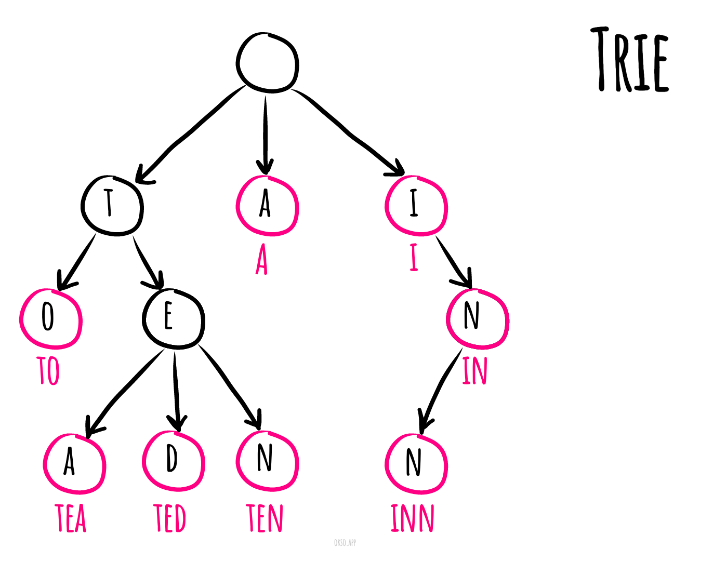

# Trie

_వేరే భాషల్లో చదవాలంటే:_
[_English_](README.md),
[_简体中文_](README.zh-CN.md),
[_Русский_](README.ru-RU.md),
[_Português_](README.pt-BR.md),
[_Українська_](README.uk-UA.md),
[_한국어_](README.ko-KO.md)

Computer science లో **trie** (దీన్నే digital tree అని, కొన్నిసార్లు radix tree లేదా prefix tree అని కూడా
అంటారు — ఎందుకంటే prefixes తో వీటిలో search చేయొచ్చు) అనేది ఒక రకమైన search tree — keys మామూలుగా
strings గా ఉండే dynamic set ని గానీ associative array ని గానీ store చేయడానికి వాడే ordered tree data
structure. Binary search tree లాగా కాకుండా, tree లో ఏ node కూడా తనకి సంబంధించిన key ని store చేయదు;
బదులుగా, tree లో దాని position నే దానికి సంబంధించిన key ఏంటో నిర్ణయిస్తుంది. ఒక node కింద ఉన్న
descendants అందరికీ, ఆ node కి సంబంధించిన string common prefix గా ఉంటుంది, ఇంకా root కి empty string
సంబంధించి ఉంటుంది. ప్రతి node కి value ఉండాల్సిన అవసరం లేదు. మామూలుగా values leaves కి, ఇంకా మనకి
కావాల్సిన keys కి సరిపోయే కొన్ని inner nodes కి మాత్రమే ఉంటాయి. Space తక్కువ వాడే prefix tree కోసం
compact prefix tree చూడండి.

*[okso.app](https://okso.app) తో తయారుచేశారు*

## References

- [Wikipedia](https://en.wikipedia.org/wiki/Trie)
- [YouTube](https://www.youtube.com/watch?v=zIjfhVPRZCg&list=PLLXdhg_r2hKA7DPDsunoDZ-Z769jWn4R8&index=7&t=0s)
